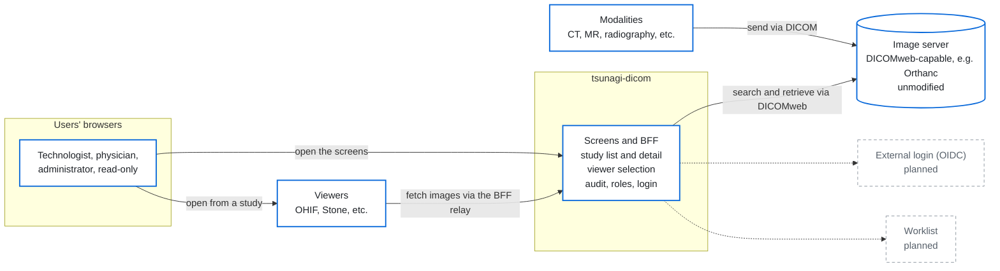
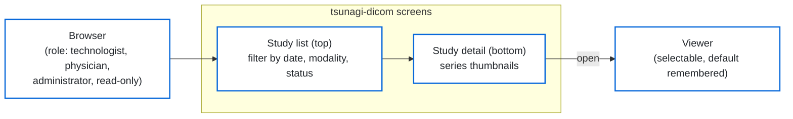
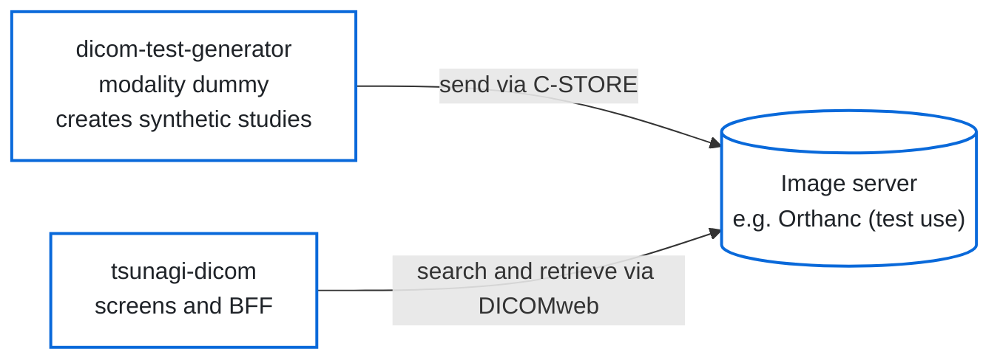

# tsunagi-dicom

[日本語](README.md)

A web screen for everyday study viewing, placed in front of a hospital's or lab's image server (a DICOMweb-capable one such as Orthanc). The image server is used **unmodified**; tsunagi-dicom adds a study list and viewer selection designed around how images are reviewed in Japanese medical institutions. It runs as a standalone web front end and BFF (Backend For Frontend).

> **This is at the trial stage. Do not use it in production (clinical settings or real patient data).** See "Notes" below for what to keep in mind.

## System overview

### Figure 1: Overall

The image server is used **unmodified**; tsunagi-dicom sits in front of it as the screens and the BFF. Viewers do not connect to the image server directly: they fetch images through the BFF relay. Dotted items are planned (see "Planned work").



### Figure 2: Roles and screens



What each role can do and see is fixed per role, and operations are recorded in the audit trail. A more detailed diagram of communications and safety is in section 2 of [`docs/security-and-maintenance.md`](docs/security-and-maintenance.md) (in Japanese).

### Trying it out together

The modality dummy ([dicom-test-generator](https://github.com/jeysunit/dicom-test-generator)) sends synthetic studies to an image server, and tsunagi-dicom views them. No real patient data is used.



## What it can do

What works today.

- **Study list**: quick filters by study date, modality, and status. Search by patient ID, name, accession number, or study description. The filters show counts. Patient names are shown split into the ideographic (kanji) name and the phonetic (kana) name; birth dates are shown with the Japanese era and age. One study per row.
- **Study detail**: below the list, the patient and study information of the selected study and its series thumbnails.
- **Status marks**: 未検像, 検像済, 未読, 既読, 緊急, and bookmark are treated as marks you set inside this screen. The marks are kept in this application, and the DICOM values on the image server are not rewritten.
- **Viewer selection**: open a study in one of the configured viewers (OHIF Viewer, Stone Web Viewer, VolView, ...). Defaults are remembered per study and per modality. Viewers fetch images through this application's relay, which allows reads only.
- **Login and roles**: user login (password plus TOTP two-factor authentication), roles (administrator, physician, technologist, read-only), and per-role limits on what can be seen and done. Temporary login lockout, screen lock, and a user inventory page are included.
- **Audit trail**: searches, detail views, opening a viewer, and status changes are recorded. The records are hash-chained so that tampering can be detected.
- **Screen**: a light background by default, switchable to dark. The screen is Japanese only.

Some checks against a real image server (Orthanc) are still to be done.

The image server and viewers are not modified. Every endpoint is configured through environment variables. Search and retrieval use DICOMweb first; Orthanc-only features are kept in separate components that are enabled only with an Orthanc backend.

**Example use**: as an everyday viewing screen in front of a hospital or lab image server.

## Planned work

Roughly in the order we plan to build them, and subject to change. This tool is for clinical trials, research, and system testing, and **features are cut rather than added**.

1. Blind-reading role: placed in front of a research image archive for clinical studies, so that readers do not see the original patient information. Includes settings for running on a closed network.
2. Per-patient timeline, and side-by-side comparison of two studies.
3. Simple reports (簡易レポート).
4. Worklist (with Orthanc), audit search and CSV export, emergency access, and a page for the safety features.
5. External login (OIDC).
6. To be decided later: document (PDF, etc.) import and display; importing, correcting, splitting, and merging other institutions' data; image-server monitoring and a read-only switch; Weasis; Passkey.

## Trying it out (mock backend)

Without an image server, run it against the mock backend (synthetic samples in `tests/fixtures/orthanc`) and development authentication (`AUTH_MODE=dev`; writes are blocked):

```sh
mkdir -p secrets && openssl rand -base64 48 > secrets/session_secret.txt   # passed as SESSION_SECRET_FILE (secrets/ is not committed)
BACKEND_MOCK=true AUTH_MODE=dev docker compose up --build
# open http://127.0.0.1:3000/
```

For local development (Node version in `.nvmrc`; npm 11 `allowScripts` is enforced by `strict-allow-scripts` in `.npmrc`):

```sh
npm ci
cp .env.example .env   # set BACKEND_MOCK="true", AUTH_MODE="dev" and SESSION_SECRET (or SESSION_SECRET_FILE)
mkdir -p data && DATABASE_URL="file:./data/tsunagi.db" npm run db:migrate
DATABASE_URL="file:./data/tsunagi.db" npm run dev
```

To try application user login (`AUTH_MODE=local`): the first administrator is created at startup from a secret file, only while there are no users (see `INITIAL_ADMIN_USERNAME` and `INITIAL_ADMIN_PASSWORD_FILE` in `compose.yaml`). At the first login the administrator enrolls TOTP (when `MFA_REQUIRED=true`) and replaces the password. **Keep at least two administrators** (if the only administrator loses the authenticator app, there is no recovery path yet; see section 4 of `docs/security-and-maintenance.md`). The session cookie is `Secure`, so outside `127.0.0.1` / `localhost` put the application behind TLS (a reverse proxy).

```sh
printf '%s\n' '<initial password>' > secrets/initial_admin_password.txt   # at least 8 characters, letters and digits
# after enabling the INITIAL_ADMIN_* and initial_admin_password secret lines in compose.yaml
BACKEND_MOCK=true AUTH_MODE=local docker compose up --build
```

Tests: `npm run lint`, `npm run typecheck`, `npm test` (Vitest), `npm run build && npm run test:e2e` (Playwright, against the mock backend, with one `AUTH_MODE=dev` server and one `AUTH_MODE=local` server).

## Container image (GHCR)

For deployment, pin the GHCR image (`ghcr.io/jeysunit/tsunagi-dicom`) by version tag (`vX.Y.Z`) or digest (`TSUNAGI_IMAGE` in `compose.yaml`). Images are published only after CI passes (`.github/workflows/image.yml`).

| Tag | When it is set |
|---|---|
| `vX.Y.Z` | Only on a version tag push. **Never set by rebuilds and never deleted by cleanup.** If the version tag already exists in GHCR (for example when a run is re-run), the workflow stops without publishing |
| `sha-<short hash>` | On merges to `main`, version tags, and weekly rebuilds. Rebuilding the same commit moves it to the new image |
| `rebuild-YYYYMMDD` | Weekly (Monday 03:17 UTC) and manual rebuilds of `main` (UTC date). Picks up updates to the packages installed with apt inside the image |

**Verifying the signature.** Each published image digest carries a keyless cosign signature made with the GitHub Actions OIDC token. Before deploying, look up the digest and verify it:

```sh
docker buildx imagetools inspect ghcr.io/jeysunit/tsunagi-dicom:vX.Y.Z   # use the Digest it prints
cosign verify ghcr.io/jeysunit/tsunagi-dicom@sha256:<digest> \
  --certificate-identity-regexp '^https://github\.com/jeysunit/tsunagi-dicom/\.github/workflows/image\.yml@refs/(heads/main|tags/v[0-9]+\.[0-9]+\.[0-9]+.*)$' \
  --certificate-oidc-issuer https://token.actions.githubusercontent.com
```

To accept only a release image, replace `--certificate-identity-regexp` with `--certificate-identity https://github.com/jeysunit/tsunagi-dicom/.github/workflows/image.yml@refs/tags/vX.Y.Z`, which also checks that the workflow run for that version signed it.

**Cleanup of old images** (`.github/workflows/image-cleanup.yml`, weekly, Monday 06:41 UTC):

- Kept: every image with a version tag (`v*`); the 10 newest images with other tags (`sha-*`, `rebuild-*`); every image published less than 2 days ago.
- Deleted: other tagged images, and untagged images (for example an old image after its `sha-*` tag moved to a rebuilt one).
- Signatures, SBOMs, provenance, and per-platform children are kept and deleted together with their parent image.
- **Currently a dry run** (nothing is deleted; the candidates are listed in the run log). The dry run will be turned off after the log has been reviewed.
- If you pin by digest, use the digest of a version-tagged image (other images are eventually deleted).

## Notes

- **This software has not been approved or certified as a medical device.** It is a screen for viewing images in research, education, and system evaluation, and is not meant for diagnosis or clinical decisions. Do not use it in production (clinical settings or real patient data).
- [`docs/guideline-mapping.md`](docs/guideline-mapping.md) maps its features to the items of the Japanese Ministry of Health, Labour and Welfare guideline (version 7.0, System Operations volume). **Whether a deployment fits the guideline is for each institution to determine, including its operations; this software alone does not settle it.**
- `AUTH_MODE=dev` starts only with the mock backend (`BACKEND_MOCK=true`).

## For contributors (where the rules live)

The development stages and the completion criteria of each stage are in "6. 段階" of [`docs/spec.md`](docs/spec.md) (in Japanese).

| Document | Contents |
|---|---|
| [`docs/spec.md`](docs/spec.md) | Specification (principles, stack, features, stages, known limitations) |
| [`docs/guideline-mapping.md`](docs/guideline-mapping.md) | Section-by-section mapping to the guideline (System Operations volume, v7.0) |
| [`docs/security-and-maintenance.md`](docs/security-and-maintenance.md) | Security and maintenance policy (system diagram, connection list, where secrets live, audit records, versioning and support period, decommissioning). In Japanese |
| [`SECURITY.md`](SECURITY.md) | How to report a vulnerability, and supported versions |
| [`docs/patient-name-test-cases.md`](docs/patient-name-test-cases.md) | Patient name test cases (machine-readable copy: `tests/fixtures/patient-names.json`) |
| [`tests/fixtures/orthanc/`](tests/fixtures/orthanc/) | Sample responses for synthetic patients used by the mock backend, and the redaction rules |
| [`AGENTS.md`](AGENTS.md) | Development rules (the same for people and for coding assistants) |
| [`.env.example`](.env.example) | Example configuration |

## License

[MIT](LICENSE). The application talks to the image server only over REST and DICOMweb and does not include its code.

## Trademarks

DICOM® is the registered trademark of the National Electrical Manufacturers Association (NEMA) for its standards publications relating to digital communications of medical information.
Other names may be trademarks of their respective owners.
