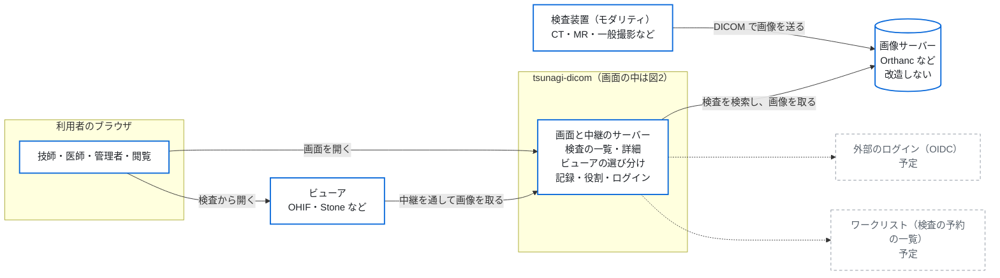
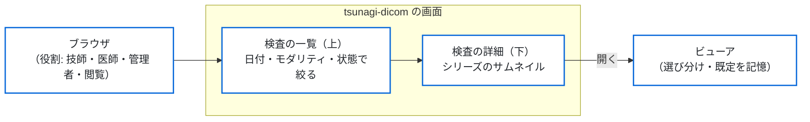
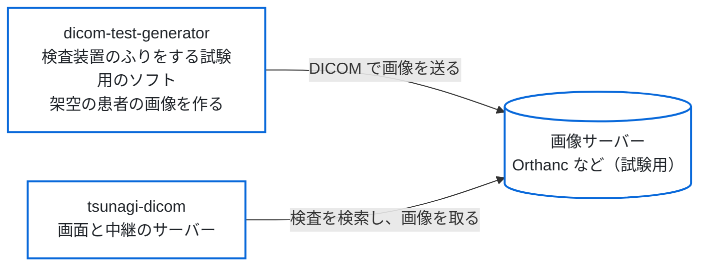

# tsunagi-dicom（つなぎだいこむ）

[English](README.en.md)

病院・研究室の画像サーバー（Orthanc など、DICOMweb に対応したもの）の前に置く、日常の閲覧の画面。画像サーバーは**改造せずに**そのまま使い、日本の医療機関の画像の見方に合わせた検査の一覧とビューアの選び分けを足す。独立した Web の画面と、その裏の中継のサーバー（BFF）として動く。中継のサーバーは、ブラウザと画像サーバーの間に立ち、ログイン・役割の確かめ・記録をしてから画像サーバーに問い合わせる部分。

> **いまは試す段階で、本番（診療の現場・実の患者のデータ）には使わない。** 使うときの注意は、下の「注意」にまとめた。

## システム構成

### 図1　全体

この図で分かること：画像サーバーの前に tsunagi-dicom を置くと、検査装置・ビューア・利用者がどうつながるか。

画像サーバー（DICOMweb に対応したもの）は**改造せずに**そのまま使い、tsunagi-dicom はその前に置く画面と中継のサーバーになる。ビューアは画像サーバーへ直接つながず、中継のサーバーを通して画像を取る。点線の部分は予定（「これからの予定」）。tsunagi-dicom の画面の中は、図2で拡大している。



### 図2　図1の tsunagi-dicom の画面の中

この図で分かること：画面の中の流れ。ブラウザから検査の一覧、詳細、ビューアへ進む。



役割ごとにできる操作と見える項目は決まっていて、操作は監査の記録に残る。通信と安全の細かい図は [`docs/security-and-maintenance.md`](docs/security-and-maintenance.md) の 2 にある。

### 図3　開発・試験のときの構成（本物の患者のデータを使わずに試す）

この図で分かること：試験のときに、検査装置のふりをするソフトと組み合わせる構成。

[dicom-test-generator](https://github.com/jeysunit/dicom-test-generator) は、CT などの検査装置のふりをして、試験用に作った架空の患者の画像を画像サーバーへ送るソフト。その画像を tsunagi-dicom で見る。本物の患者のデータは使わない。



## できること

いま使える機能。

- **検査の一覧**：検査日・モダリティ・状態ですぐ絞れる。患者 ID・氏名・受付番号・検査の記述での検索もできる。絞り込みの見出しには件数が付く。氏名は漢字とかなに分けて出し、生年月日は和暦と年齢で出す。1 件を 1 行で並べる。
- **検査の詳細**：一覧の下に、選んだ検査の患者・検査の情報とシリーズのサムネイルを出す。
- **状態の印**：未検像・検像済・未読・既読・緊急・ブックマークを、この画面の中で付ける印として扱う。印はこのアプリの中に持ち、画像サーバーの DICOM の値は書き換えない。
- **ビューアの選び分け**：OHIF Viewer・Stone Web Viewer・VolView など、設定で与えたビューアから選んで開く。検査ごと・モダリティごとに既定を覚える。ビューアは、このアプリの中継（読み取りだけ）から画像を取る。
- **ログインと役割**：利用者のログイン（パスワードと、二要素の認証の TOTP）、役割（管理者・医師・技師・閲覧）、役割ごとに見える項目とできる操作の制限。ログインの一時停止、画面のロック、利用者の棚卸しの画面もある。
- **監査の記録**：検索・詳細の表示・ビューアで開いたこと・状態を変えたことを記録する。記録はハッシュでつなぎ、書き換えを見つけられる。
- **画面**：明るい地を既定にし、暗い地に切り替えられる。画面は日本語だけ。

実の画像サーバー（Orthanc）での確かめは、一部がまだ残っている。

画像サーバーとビューアのソースには手を入れない。つなぎ先はすべて設定（環境変数）で決める。検索と取得は DICOMweb を先に使い、Orthanc にしか無い機能は「Orthanc のときだけ有効」な部品に分ける。

**使い方の例**：病院・研究室の画像サーバーの前に置く、日常の閲覧の画面として。

## これからの予定

作る順に近い並びで、変わることがある。この道具は治験・研究・システムの試験のための道具で、**機能は足すより削る**。

1. ブラインド読影の役割：臨床研究の画像の集め先（研究用の画像サーバー）の前に置き、読む人に元の患者の情報を見せない。閉じた網で動かすための設定も含む。
2. 患者ごとの時系列と、2つの検査の比較。
3. 簡易レポート。
4. ワークリスト（Orthanc のとき）、監査の検索と CSV、緊急のアクセス、安全の機能の頁。
5. 外部のログイン（OIDC）。
6. その後に決めるもの：文書（PDF など）の取り込みと表示、他の施設のデータの取り込み・値の修正・分割・結合、画像サーバーの監視と読み取りだけの切り替え、Weasis、Passkey。

## 試しに動かす（モック）

画像サーバー無しで、架空の患者の見本（`tests/fixtures/orthanc`）を返すモックのバックエンドと、開発用の認証（`AUTH_MODE=dev`、書き込みは止める）で動かす。

```sh
mkdir -p secrets && openssl rand -base64 48 > secrets/session_secret.txt   # SESSION_SECRET_FILE で渡す（secrets/ はリポジトリに入れない）
BACKEND_MOCK=true AUTH_MODE=dev docker compose up --build
# http://127.0.0.1:3000/ を開く
```

手元で開発するとき（Node は `.nvmrc` の版。npm 11 の `allowScripts` を `.npmrc` の `strict-allow-scripts` で効かせている）：

```sh
npm ci
cp .env.example .env   # BACKEND_MOCK="true"・AUTH_MODE="dev"・SESSION_SECRET（か SESSION_SECRET_FILE）を入れる
mkdir -p data && DATABASE_URL="file:./data/tsunagi.db" npm run db:migrate
DATABASE_URL="file:./data/tsunagi.db" npm run dev
```

アプリの利用者のログイン（`AUTH_MODE=local`）で試すとき：最初の管理者は、利用者が1人もいないときだけ、起動の時に秘密のファイルから作る（`compose.yaml` の `INITIAL_ADMIN_USERNAME`・`INITIAL_ADMIN_PASSWORD_FILE` の例）。最初のログインで TOTP（`MFA_REQUIRED=true` のとき）を登録し、パスワードを本人のものに変える。**管理者は2人以上置く**（管理者が1人だけで認証のアプリを失くすと、いまは戻す道が無い。`docs/security-and-maintenance.md` の 4）。cookie は `Secure` なので、手元（`127.0.0.1`・`localhost`）のほかでは TLS（リバースプロキシ）の後ろに置く。

```sh
printf '%s\n' '<最初のパスワード>' > secrets/initial_admin_password.txt   # 8 文字以上・英字と数字を両方含める
# compose.yaml の INITIAL_ADMIN_* と secrets の initial_admin_password の行を有効にしてから
BACKEND_MOCK=true AUTH_MODE=local docker compose up --build
```

試験：`npm run lint`・`npm run typecheck`・`npm test`（Vitest）・`npm run build && npm run test:e2e`（Playwright。モックに対して、`AUTH_MODE=dev` と `AUTH_MODE=local` のサーバーを起こして流す）。

## イメージ（GHCR）

配備では、GHCR のイメージ（`ghcr.io/jeysunit/tsunagi-dicom`）を版のタグ（`vX.Y.Z`）か digest で指定する（`compose.yaml` の `TSUNAGI_IMAGE`）。イメージは CI が通ってから出す（`.github/workflows/image.yml`）。

| タグ | いつ付くか |
|---|---|
| `vX.Y.Z` | 版のタグの push のときだけ。**作り直しでは付けず、片付けでは消さない。** 同じ版のタグがもう GHCR にあれば（実行のやり直しなど）、出さずに止める |
| `sha-<短い hash>` | `main` への merge・版のタグ・週の作り直し。同じ commit を作り直すと、新しいイメージへ移る |
| `rebuild-YYYYMMDD` | 週に1回（月曜 03:17 UTC）と手動の、`main` の作り直し（日付は UTC）。イメージの中で apt で入れる包みの更新を取り込む |

**署名の確かめ。** 出したイメージの digest には、GitHub Actions の OIDC による cosign の鍵の要らない署名が付いている。配備の前に、digest を調べて確かめる：

```sh
docker buildx imagetools inspect ghcr.io/jeysunit/tsunagi-dicom:vX.Y.Z   # 出てくる Digest を使う
cosign verify ghcr.io/jeysunit/tsunagi-dicom@sha256:<digest> \
  --certificate-identity-regexp '^https://github\.com/jeysunit/tsunagi-dicom/\.github/workflows/image\.yml@refs/(heads/main|tags/v[0-9]+\.[0-9]+\.[0-9]+.*)$' \
  --certificate-oidc-issuer https://token.actions.githubusercontent.com
```

版のタグのイメージだけを受け入れるなら、`--certificate-identity-regexp` の代わりに `--certificate-identity https://github.com/jeysunit/tsunagi-dicom/.github/workflows/image.yml@refs/tags/vX.Y.Z` で、その版の workflow が署名したことまで確かめる。

**古いイメージの片付け**（`.github/workflows/image-cleanup.yml`、週に1回、月曜 06:41 UTC）：

- 残す：版のタグ（`v*`）の付いたイメージは全部。ほかのタグ（`sha-*`・`rebuild-*`）の付いたイメージは新しい順に 10 個。出してから 2 日より新しいイメージは全部。
- 消す：上に当たらないタグ付きのイメージと、タグの無いイメージ（`sha-*` のタグが新しいイメージへ移った後の古いイメージなど）。
- 署名・SBOM・provenance・プラットフォーム別の子は、親のイメージと一緒に残し、一緒に消す。
- **いまは dry-run**（消さずに、消す候補を実行の記録に出すだけ）。記録を確かめてから dry-run を外す。
- digest で止めて配備するなら、版のタグの付いたイメージの digest を使う（ほかのイメージは、いずれ消える）。

## 注意

- **医療機器としての承認・認証を受けていない。** 研究・教育・システムの検証で画像を見るための画面で、診断や診療の判断に使うためのものではない。本番（診療の現場・実の患者のデータ）には使わない。
- 厚生労働省のガイドライン（第7.0版 システム運用編）の項目との対応を [`docs/guideline-mapping.md`](docs/guideline-mapping.md) に示す。**ガイドラインに合っているかどうかは、運用を含めて各施設が判断する。このソフトウェアだけでは決まらない。**
- `AUTH_MODE=dev` は、モックのバックエンド（`BACKEND_MOCK=true`）のときだけ起動する。

## 作る側の資料（決まりの在り処）

開発の段階と、各段の完了の線は [`docs/spec.md`](docs/spec.md) の「6. 段階」にある。

| 文書 | 中身 |
|---|---|
| [`docs/spec.md`](docs/spec.md) | 仕様（原則・技術の構成・機能・段階・既知の制約） |
| [`docs/guideline-mapping.md`](docs/guideline-mapping.md) | 第7.0版 システム運用編の節ごとの対応表 |
| [`docs/security-and-maintenance.md`](docs/security-and-maintenance.md) | セキュリティと保守の方針（システム構成図・通信の一覧・秘密の置き場・記録・版と支える期間・使い終えるときの片付け） |
| [`SECURITY.md`](SECURITY.md) | 脆弱性の報告の窓口と支える版 |
| [`docs/patient-name-test-cases.md`](docs/patient-name-test-cases.md) | 氏名の形の試験の一覧（機械で読める写しは `tests/fixtures/patient-names.json`） |
| [`tests/fixtures/orthanc/`](tests/fixtures/orthanc/) | モックに使う、架空の患者の応答の見本と、その置き換えの規則 |
| [`AGENTS.md`](AGENTS.md) | 開発の決まり（人にも、コーディングの支援の道具にも同じ） |
| [`.env.example`](.env.example) | 設定の例 |

## ライセンス

[MIT](LICENSE)。画像サーバーとは REST・DICOMweb でやり取りするだけで、そのコードを取り込まない。

## 商標

DICOM® は、医療の情報のデジタルの通信に関する規格の出版物について、米国 National Electrical Manufacturers Association（NEMA）の登録商標。
そのほかの名前は、それぞれの持ち主の商標であることがある。
