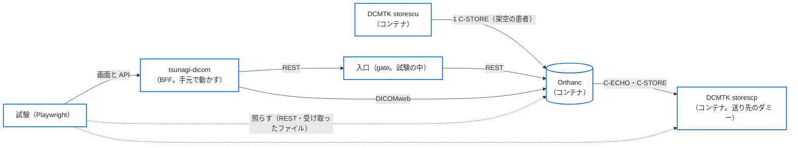

# 結合の試験（本物の Orthanc と DCMTK）

本物の Orthanc と DCMTK を試験の中のコンテナで立て、BFF（`BACKEND_MOCK=false`・`AUTH_MODE=local`）を通して、受け取る → 見る → 送る → 書き出す → 消すを一巡りする試験。
[`round-trip-test.md`](round-trip-test.md) の手順を、検査装置の試験用のソフトの代わりに DCMTK（`storescu`・`storescp`）で、CI の中で毎回流すもの。
画面の細かい振る舞い・役割ごとの許す・断るはモックの試験（`tests/e2e`）で見る。ここでは BFF と Orthanc のつなぎ（REST・DICOMweb・仕事・誤りの形）を見る。

- **相手は試験の中のコンテナだけ。** 施設の画像サーバーにはつながない。
- **架空の患者だけ。** 試験の画像は試験の中で作る（患者 ID は `JP-TEST-IT` で始まる。8×8 の画像）。実の患者のデータは使わない。
- **資格情報は試験のたびに乱数で作る**（Orthanc の利用者、tsunagi-dicom の最初の管理者、`SESSION_SECRET`）。`.e2e/itest/`（`.gitignore`）にだけ置き、リポジトリにも CI の記録にも出さない。

## 構成



| ファイル | 中身 |
|---|---|
| `docker/test/compose.yaml` | Orthanc・storescp・storescu（`scu`。profile `tools`）。待ち受けは 127.0.0.1 だけ |
| `docker/test/orthanc/orthanc.json` | Orthanc の設定（秘密は無い）。送り先 `itest-scp`（`ITEST_SCP`・`storescp`・11112）を設定のファイルで登録する |
| `docker/test/dcmtk/Dockerfile` | DCMTK のイメージ（Debian の公式のイメージと Debian の包みで作る。配布しない） |
| `tests/integration/run.mjs` | 資格情報を作り、コンテナを立て、Playwright を流し、片付ける |
| `tests/integration/orthanc.spec.ts` | 試験の本体 |
| `tests/integration/support/` | 試験の画像（dump）・コンテナの操作・Orthanc の REST・入口（gate）・ZIP の読み取り・実測の記録 |

### イメージの版

| イメージ | 版 | digest（multi-arch） | 選んだ理由 |
|---|---|---|---|
| `orthancteam/orthanc` | 26.9.1 | `sha256:d2705f2c56547e55ce9bc2250fd22d05d326493b3f3d9fa191ecb7db8ca6b5a2` | Orthanc の作り手のチームが出す公式のイメージ。DICOMweb のプラグインが入っている。施設で動かす Orthanc と同じ系統 |
| `debian`（DCMTK の土台） | trixie-20260918-slim | `sha256:a99cfc517144bc59b1978475ec53b46ecabec7e43635402ee5b77cc54cd1b20a` | DCMTK を作っている側が出す公式のイメージは無い。知らない人が作ったイメージを使わず、Debian の公式のイメージに Debian の署名つきの包み `dcmtk`（3.6.9。Debian の安全の直しは受ける）を入れて作る |

版を上げるときは、この試験を流してから、[`round-trip-test.md`](round-trip-test.md) の「実測で決めること」の版と結果を書き直す。

## 試すこと

| # | 試験 | 確かめること |
|---|---|---|
| 1 | 受信一覧 | storescu（`ITEST_SCU`）から送った検査が、受け取りの記録（`/api/receive-log`）に新しい順に出る。送り元の AE タイトル・`Origin`（`DicomProtocol`）・画像の数が合う。時刻が Orthanc の時計のとおりに出る |
| 2 | 接続先の一覧と接続確認 | 設定のファイルで登録した `itest-scp` が、名前・AE タイトル・住所とともに出る。C-ECHO で「つながった」 |
| 3 | 検査の一覧・詳細 | QIDO-RS と REST の本物の答えで一覧と詳細が開く。氏名（`ISO_IR 192`。ローマ字・漢字・かな）が崩れない。中継は WADO-RS の metadata を通し、検索は通さない。Orthanc のパスワードが頁と API の答えに出ない |
| 4 | 送信 | 画面から `itest-scp` へ送ると「送った」になり、storescp に同じ SOPInstanceUID の画像が同じ数だけ届く |
| 5 | 送り先を止めて送る | storescp を止めると、C-ECHO は「つながらない」、送ると「送れなかった」と Orthanc の誤りの文言が出る |
| 6 | エクスポート | ZIP が開け、中の DICOM のファイルの数が画像の数と合う |
| 7 | 削除 | 管理者が理由と再認証（パスワード）を通して消すと、Orthanc から消える（再認証の前は消えない） |
| 8 | 答えが失われたとき（[`round-trip-test.md`](round-trip-test.md) の 7） | 入口（gate）が送る要求の答えを捨てて 504 を返すと、Orthanc は送るが画面は「結果が分からない」と要求の ID を出す。同じ検査・同じ送り先へは重ねて送れない。管理者が「届いていた」を記録すると、また送れる |
| 9 | 監査のつなぎ | `/api/audit/verify` が `ok`。試験の操作の分だけ行が増えている |

試験の中で測った Orthanc の実の振る舞い（メタデータの名前・`/changes` の上限・仕事の状態の移り方・`ErrorCode`）は、`test-results/integration/observations.json` に書き出し、CI の記録にも `[itest-observation]` の行で出す（名前・数・状態・誤りの番号と文言だけ。資格情報と住所は出さない）。結果は [`round-trip-test.md`](round-trip-test.md) の「実測で決めること」に写す。

## 流し方

CI では、PR ごとに `.github/workflows/integration.yml` の仕事（`結合の試験（Orthanc・DCMTK のコンテナ）`）が流れる。いまは必須のチェックにしていない。

手元で流すときは、Docker（compose v2）が要る（WSL で Docker が無いときは、CI に任せる）。

```sh
npm ci
npx playwright install chromium
npm run build
node tests/integration/run.mjs
# 1 つの試験だけ：node tests/integration/run.mjs -g "送信"
# 終わってもコンテナを残す（調べるため）：ITEST_KEEP=1 node tests/integration/run.mjs
```

- 使うポート：BFF 3104、Orthanc の HTTP 18042（`ITEST_ORTHANC_HTTP_PORT` で替えられる）、入口 18043。どれも 127.0.0.1 だけ。
- 失敗したときは、`run.mjs` がコンテナの記録（`docker compose logs`）を出してから片付ける。画面の記録は `playwright-report/integration/`・`test-results/integration/`。
- 残したコンテナは `docker compose -f docker/test/compose.yaml down --volumes` で片付ける（compose の変数が要るので、`ITEST_DUMP_DIR` と `ITEST_ORTHANC_USERS_FILE` に `.e2e/itest/` の中の場所を渡す）。
