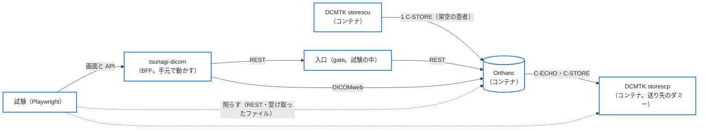

# 結合の試験（本物の Orthanc と DCMTK）

本物の Orthanc と DCMTK を試験の中のコンテナで立て、BFF（`BACKEND_MOCK=false`・`AUTH_MODE=local`）を通して、受け取る → 見る → 送る → 書き出す → 消すを一巡りする試験。
[`round-trip-test.md`](round-trip-test.md) の流れ（受け取る → 見る → 送る）を、検査装置の試験用のソフトの代わりに DCMTK（`storescu`・`storescp`）で、CI の中で毎回流すもの。
画面の細かい振る舞い・役割ごとの許す・断るはモックの試験（`tests/e2e`）で見る。ここでは BFF と Orthanc のつなぎ（REST・DICOMweb・仕事・誤りの形）を見る。

- **相手は試験の中のコンテナだけ。** 施設の画像サーバーにはつながない。
- **架空の患者だけ。** 試験の画像は試験の中で作る（患者 ID は `JP-TEST-IT` で始まる。8×8 の画像）。実の患者のデータは使わない。
- **資格情報は試験のたびに乱数で作る**（Orthanc の利用者、tsunagi-dicom の最初の管理者、`SESSION_SECRET`）。`.e2e/itest/`（`.gitignore`）にだけ置き、リポジトリにも CI の記録にも出さない。

## 構成



| ファイル | 中身 |
|---|---|
| `docker/test/compose.yaml` | Orthanc・storescp・storescu（`scu`。profile `tools`）。待ち受けは 127.0.0.1 だけ |
| `docker/test/orthanc/orthanc.json` | Orthanc の設定（秘密は無い）。送り先 `itest-scp`（`ITEST_SCP`・`storescp`・11112）を設定のファイルで登録する |
| `docker/test/dcmtk/Dockerfile` | DCMTK のイメージ（Debian の公式のイメージと Debian の包みで作る。配布しない） |
| `tests/integration/run.mjs` | 資格情報を作り、コンテナを立て、Playwright を流し、片付ける |
| `tests/integration/orthanc.spec.ts` | 試験の本体 |
| `tests/integration/support/` | 試験の画像（dump）・コンテナの操作・Orthanc の REST・入口（gate）・ZIP の読み取り・実測の記録 |

### イメージの版

| イメージ | 版 | digest（multi-arch） | 選んだ理由 |
|---|---|---|---|
| `orthancteam/orthanc` | 26.9.1 | `sha256:d2705f2c56547e55ce9bc2250fd22d05d326493b3f3d9fa191ecb7db8ca6b5a2` | Orthanc の作り手のチームが出す公式のイメージ。DICOMweb のプラグインが入っている。施設で動かす Orthanc と同じ系統 |
| `debian`（DCMTK の土台） | trixie-20260918-slim | `sha256:a99cfc517144bc59b1978475ec53b46ecabec7e43635402ee5b77cc54cd1b20a` | DCMTK を作っている側が出す公式のイメージは無い。知らない人が作ったイメージを使わず、Debian の公式のイメージに Debian の署名つきの包み `dcmtk`（3.6.9。Debian の安全の直しは受ける）を入れて作る |

DCMTK の土台（Debian）は Dependabot が週に1回、更新の PR を出す（`.github/dependabot.yml`）。Orthanc のイメージは compose のファイルにあり Dependabot の外なので、手で上げる。
版を上げるときは、この試験を流してから、下の「[Orthanc の実の振る舞いの記録](#orthanc-の実の振る舞いの記録)」の版と結果を書き直す。

## 試すこと

| # | 試験 | 確かめること |
|---|---|---|
| 1 | 受信一覧 | storescu（`ITEST_SCU`）から送った検査が、受け取りの記録（`/api/receive-log`）に新しい順に出る。送り元の AE タイトル・`Origin`（`DicomProtocol`）・画像の数が合う。時刻が Orthanc の時計のとおりに出る |
| 2 | 接続先の一覧と接続確認 | 設定のファイルで登録した `itest-scp` が、名前・AE タイトル・住所とともに出る。C-ECHO で「成功」（時刻つき） |
| 3 | 検査の一覧・詳細 | QIDO-RS と REST の本物の答えで一覧と詳細が開く。氏名（`ISO_IR 192`。ローマ字・漢字・かな）が崩れない。中継は WADO-RS の metadata を通し、検索は通さない。Orthanc のパスワードが頁と API の答えに出ない |
| 4 | 送信 | 画面から `itest-scp` へ送ると「送信完了」（送信先・画像の数・時刻つき）になり、storescp に同じ SOPInstanceUID の画像が同じ数だけ届く |
| 5 | 送り先を止めて送る | storescp を止めると、C-ECHO は「失敗」、送ると「送信失敗」と Orthanc の誤りの文言が出る |
| 6 | エクスポート | ZIP が開け、中の DICOM のファイルの数が画像の数と合う |
| 7 | 削除 | 管理者が理由と再認証（パスワード）を通して消すと、Orthanc から消える（再認証の前は消えない） |
| 8 | 答えが失われたとき（Orthanc が受けた後に、tsunagi-dicom との間の入口の応答が失われる） | 入口（gate）が送る要求の答えを捨てて 504 を返すと、Orthanc は送るが画面は「送信結果を確認できません」と要求の ID を出す。同じ検査・同じ送り先へは重ねて送れない。管理者が「送信済みとして記録」すると、開き直してまた送れる |
| 9 | 監査のつなぎ | `/api/audit/verify` が `ok`。送る・削除・照らし合わせの要求ごとに「求めた」「結果」「終わり」の行が要求の ID で結ばれ、結果不明の間に重ねた要求は断った行だけが残る。C-ECHO の成功と失敗が残る |
| 10 | 見つけて直した食い違い | 書き出しの「結果」の行が残る。サムネイルがブラウザの Accept のまま画像で返る。2026-10-20 に見つけ、PR #33 で直した（下の「[結合の試験で見つけて直した、BFF の食い違い](#結合の試験で見つけて直したbff-の食い違い)」） |
| 11 | 詳細条件（2026-10-21） | 生年月日・性別・受付番号・検査名で、画面の API（`/api/studies?birth=…&sex=…&accession=…&desc=…`）が Orthanc の QIDO-RS で絞った検査を返す。小文字で求めたときの Orthanc の答えと BFF の答えを並べて記録する（Orthanc 26.9.1 は大文字と小文字を区別しなかった） |
| 12 | 画像単位の DICOM タグ（2026-10-21） | シリーズの中の画像の並び（QIDO-RS）が画像の番号の順に出て、1 枚の値（WADO-RS の metadata）がその画像の SOPInstanceUID のものになる。別のシリーズの下としては返さない |
| 13 | 上限を超えたとき（2026-10-21） | 古い検査 1001 件のあとに、いちばん新しい検査を入れる（Orthanc の REST の `tools/create-dicom`。架空の患者）。画面の API（`/api/studies`）の一覧の先頭に、いちばん新しい検査が出る。件数は「以上」（`exact: false`）で、外れるのは古い側の検査だけ。範囲（2020 年 1 月）の中は確定の 31 件。Orthanc の QIDO-RS が `limit` で切ったときに返す順と、`Warning` の有無を記録する（[`spec.md`](spec.md) の 3.1「上限に届いたとき」） |

試験の中で測った Orthanc の実の振る舞い（メタデータの名前・`/changes` の上限・仕事の状態の移り方・`ErrorCode`）は、`test-results/integration/observations.json` に書き出し、CI の記録にも `[itest-observation]` の行で出す（名前・数・状態・誤りの番号と文言だけ。資格情報と住所は出さない）。結果は、下の「Orthanc の実の振る舞いの記録」に写す。

## 流し方

CI では、PR ごとに `.github/workflows/integration.yml` の仕事（`結合の試験（Orthanc・DCMTK のコンテナ）`）が流れる。いまは必須のチェックにしていない。

手元で流すときは、Docker（compose v2）が要る（WSL で Docker が無いときは、CI に任せる）。

```sh
npm ci
npx playwright install chromium
npm run build
node tests/integration/run.mjs
# 1 つの試験だけ：node tests/integration/run.mjs -g "送信"
# 終わってもコンテナを残す（調べるため）：ITEST_KEEP=1 node tests/integration/run.mjs
```

- 使うポート：BFF 3104、Orthanc の HTTP 18042（`ITEST_ORTHANC_HTTP_PORT` で替えられる）、入口 18043。どれも 127.0.0.1 だけ。
- 失敗したときは、`run.mjs` がコンテナの記録（`docker compose logs`）を出してから片付ける。画面の写しと手がかりは `test-results/integration/`（CI の成果物には、測った値の `observations.json` と画面の写しだけを上げる）。
- CI では、`run.mjs` が作った値を GitHub Actions の伏せ字（`::add-mask::`）に登録してから試験を流す（失敗した操作の記録に、入力した値が出ても伏せ字になる）。手元で流したときの出力は伏せない（手元の画面にだけ出る）。
- trace と HTML の報告は作らない。入力した値（試験だけの管理者のパスワード）と通信の中身が残り、CI の成果物として外に出るため。
- 監査の記録は、`/api/audit/verify` のつなぎに加えて、試験の BFF のデータベース（`.e2e/itest/itest.db`）を読むだけで開き、送る・削除・書き出しの要求ごとに「求めた」「結果」「終わり」の行が要求の ID で結ばれていることを照らす（`tests/integration/support/audit-db.ts`）。
- 残したコンテナは `docker compose -f docker/test/compose.yaml down --volumes` で片付ける（compose の変数が要るので、`ITEST_DUMP_DIR` と `ITEST_ORTHANC_USERS_FILE` に `.e2e/itest/` の中の場所を渡す）。

## 開発用の compose の流れ（`tests/flow`）

同じ workflow の、もう1つの仕事（`開発用の compose の流れ（RIS → DTG → Orthanc → tsunagi-dicom → storescp）`）。この試験と違い、BFF もコンテナ（このリポジトリから作るイメージ）で動かし、配る compose（`deploy/compose.yaml`）の形のまま確かめる。人が画面で試す手順は [`round-trip-test.md`](round-trip-test.md)。

- `tests/flow/run.mjs` が `docker/dev/up.sh` で一式を立て、`tests/flow/flow.spec.ts` を流し、片付ける（`FLOW_KEEP=1` なら残す）。compose のプロジェクトは `tsunagi-flow`、ポートは画面 13000・DICOM 14242・DTG の Web 画面 18180・ris-emulator の Web 画面 18181 で、手元で使っている開発用の一式（`tsunagi-dev`）とは volume もポートも分ける。
- 確かめること：Orthanc の REST（8042）がホストに公開されていない。内部ネットワーク `backend` が `internal: true` で、tsunagi-dicom と Orthanc だけが入る。ホストに公開した DICOM（4242）に C-ECHO が通る。ris-emulator は Web 画面（8081）だけを 127.0.0.1 に公開し、MWL（11112）は公開しない。DTG の CLI で送った架空の患者が受信一覧に出て、tsunagi-dicom から storescp へ送信すると、同じ StudyInstanceUID・SOPInstanceUID の画像が同じ数だけ届く。ris-emulator の CLI で作った予約を、DTG がワークリスト（MWL）で取得して撮り、Orthanc へ送ると、tsunagi-dicom の検査の一覧に、予約の StudyInstanceUID・受付番号・患者 ID で出る。
- CI の記録に `[flow]` の行で、各段の画像の数を出す。

```sh
npm ci
npx playwright install chromium
node tests/flow/run.mjs
```

## CI で流さない確かめ

次の確かめは、試しの環境（架空の患者だけ）で人が行い、結果を PR に書く。施設の本番の環境では行わない。

- **操作ログが書けないとき**：tsunagi-dicom の `/data` を読み取りだけにしてから、検査を送る。「求めた」を記録できないので、tsunagi-dicom は Orthanc を呼ばずにエラーを返す（Orthanc の `/jobs` に新しい仕事ができず、送信先にも届かない）。`/data` を戻してから、管理者で `/api/audit/verify` を開き、記録のつなぎが壊れていないことを確かめる。

## Orthanc の実の振る舞いの記録

### 結合の試験で測った結果（2026-10-20）

結合の試験で、`orthancteam/orthanc:26.9.1`（Orthanc 1.13.0、REST の API の版 31、DICOMweb のプラグイン 1.24）を相手に測った。送る側は DCMTK 3.6.9 の storescu、送り先は storescp。試験は CI で毎回流れ、測った値は `test-results/integration/observations.json` と CI の記録の `[itest-observation]` の行に出る。

| 項目 | 測った結果 | モックの見本・BFF の前提との違い |
|---|---|---|
| 画像のメタデータ（`/instances/{id}/metadata?expand`）の名前 | `CalledAET`・`IndexInSeries`・`MainDicomTagsSignature`・`Origin`・`PixelDataOffset`・`ReceptionDate`・`RemoteAET`・`RemoteIP`・`SopClassUid`・`TransferSyntax` | 見本（`made/instance-metadata.json`）の 5 つ（`CalledAET`・`Origin`・`ReceptionDate`・`RemoteAET`・`TransferSyntax`）は名前も形も合う。名前は `RemoteAET`（BFF が先に読む名前）。見本に無い名前は BFF が読まないので、違いにならない |
| メタデータの値 | C-STORE で受けた画像は `Origin` が `DicomProtocol`、`RemoteAET` が送ってきた側の AE タイトル、`CalledAET` が Orthanc の AE タイトル。`ReceptionDate` は `YYYYMMDDTHHMMSS` | 見本と合う |
| `/changes` の `Date` と `ReceptionDate` の時間帯 | UTC（時間帯の印なし）。Orthanc のコンテナの時間帯を `Asia/Tokyo`（`+0900`）にしても UTC のまま | [`spec.md`](spec.md) の 3.3 の「Date は UTC」と合う。測った時点（2026-10-20）の BFF の `receivedAt` は印なしで返り、頁は UTC の時刻をそのまま出していた（いまの振る舞いは [`spec.md`](spec.md) の 3.3。試験は印なしと `Z` つきの両方を受ける） |
| `/changes?last` | 最後の変更 1 件を返す（名前は `Changes`・`Done`・`First`・`Last`。`Done` は `true`） | BFF が使う `Last` は合う。`First` は見本に無いが、BFF は読まない |
| `/changes` が 1 回に返す数 | `since=0&limit=1000` で、全部の 155 件を 1 回で返した（`Done` は `true`）。100 件では切り詰めない | BFF は 100 件ずつ求めて `Last` から続けて読むので、どちらでも抜けない。1000 件を超えたときの上限は測っていない |
| `/studies/{id}/series` | シリーズごとに `Instances`（画像の ID の並び）を返す | BFF の読み方の前提と合う |
| 送るの非同期の答え（`POST /modalities/{id}/store`、`Synchronous: false`） | `ID` と `Path` | BFF は `ID` だけを読む。合う |
| 送るの仕事の状態の移り方 | 画像 120 枚の送るで `Running` → `Success`（空いた Orthanc では `Pending` を読めなかった） | モックは `Pending` → `Running` → `Success`。実では `Pending` を飛ばすことがあるが、画面は `Pending` が無くても終わりまで出す（試験の 4 で確かめた） |
| 仕事の JSON の名前 | `CompletionTime`・`Content`・`CreationTime`・`EffectiveRuntime`・`ErrorCode`・`ErrorDescription`・`ErrorDetails`・`ID`・`Priority`・`Progress`・`State`・`Timestamp`・`Type`。`Content` は `Description`・`FailedInstancesCount`・`InstancesCount`・`LocalAet`・`ParentResources`・`RemoteAet`・`Resources` | BFF が読む名前（`ID`・`State`・`Progress`・`ErrorCode`・`ErrorDescription`・`CreationTime`・`CompletionTime`）はある |
| 成功のとき | `ErrorCode` 0、`ErrorDescription` は `Success` | モックと合う |
| 送り先が止まっているとき | `State` が `Failure`、`ErrorCode` 9、`ErrorDescription` は `Error in the network protocol`、`ErrorDetails` に送り先へつなげなかった理由（送り先の名前を引けない） | モックの見本（`ErrorCode` 9・`Error in the network protocol`）と合う。BFF は `ErrorDetails` を画面に返さない |
| C-ECHO が通らないとき | Orthanc は 500 と、誤りの JSON（`Details`・`HttpError`・`HttpStatus`・`Message`・`Method`・`OrthancError`・`OrthancStatus`・`Uri`）を返す | BFF の前提（500 を「つながらない」と読む）と合う |
| 書き出し（`/studies/{id}/archive`） | 画像の数だけの DICOM のファイルの ZIP（患者・検査・シリーズのフォルダの下）。ほかのファイルは無い | 合う |
| 受けた後に答えが失われたとき（試験の 8） | 入口が 504 を返しても、Orthanc は仕事を作って送り先へ送る | BFF の結果不明の扱い（[`spec.md`](spec.md) の 3.5）の前提と合う |

### 結合の試験で測った結果（2026-10-21）

同じ版の Orthanc を相手に、結合の試験の 13 で測った。

| 項目 | 測った結果 | BFF の前提との違い |
|---|---|---|
| QIDO-RS の検査の検索を `limit` で切ったときの順（検査 1007 件、`limit=1000`） | 1000 件を返した。検査日の新しい順でも古い順でもなかった。2 回流して、並びは 2 回とも違った（先頭の 3 件の検査日は、1 回目が 2021-11-25・2021-12-03・2020-06-29、2 回目が 2021-04-15・2021-06-08・2021-02-18。検査の UID は流すたびに作り直す）。最後に入れたいちばん新しい検査は、2 回とも 1000 件の中にあった | 規格（PS3.18 8.3.4.4）は順を決めていない。BFF は `limit` の答えを「新しい順の 1000 件」とみなさず、検査日の範囲で区切って問い合わせ直す（[`spec.md`](spec.md) の 3.1「上限に届いたとき」） |
| 続きがあるときの `Warning: 299` | 付けなかった（`limit=1000` でも `limit=1001` でも） | 規格は付けるとする（8.3.4.4.1）。BFF は `Warning` が無くても、返した数が求めた数（上限＋1）に届いたら「続きがある」と読む |
| `limit=1001` | 1001 件を返した（Orthanc の側で 1000 件などに切り詰めない） | BFF は上限＋1 を求めて「続きがある」かを見る前提と合う。画像サーバーが求めた数より少なく切り詰めて、`Warning` も付けないと、続きがあることを知る手段が無い |

### 結合の試験で見つけて直した、BFF の食い違い

結合の試験の 10 で見つけ、PR #33 で直した（いまは結合の試験の 10 が緑）。

- **サムネイルが出なかった。** 一覧と詳細の `` がブラウザの既定の Accept（`image/avif,image/webp,…,image/*,*/*;q=0.8`）のまま中継（`/api/dicom-web/…/thumbnail`）を通ると、DICOMweb のプラグインは 400（`Unsupported MIME type in WADO-RS rendered frame`）を返していた。`Accept: image/jpeg` なら 200 で JPEG を返す。モックはサムネイルの見本の PNG を Accept に依らず返すので、モックの試験では見えなかった。直し方：中継が `thumbnail`・`rendered` の要求に限って、Orthanc へ送る Accept を BFF が決める。
- **書き出しの「結果」の行が操作ログに残らなかった。** ZIP は流れ切るが、操作ログには「求めた」の行だけが残り、BFF のログに `export_result_not_recorded` が出ていた。本文を流し終えたときに書く記録（`src/app/api/studies/[uid]/export/route.ts` の `watchedBody`）が、`audit()` の中で要求のヘッダー（`headers()`）を読むが、応答を返した後なので読めずに失敗していた。直し方：送信元をルートの中で先に読んでおき、流し終えたときはそれを使って書く。

### まだ測っていないこと

- 接続先の数が多いとき・受信一覧の件数が多いときの、画面の応答の時間。
- `/changes` が 1 回に返す数の上限（1000 件を超えたとき）。
- 施設の環境に近い Orthanc（データベースの差し替え・入口のリバースプロキシ・TLS）での、上の結果の違い。

結果は、測った PR に書く（どの Orthanc の版で、何が期待どおりで、何が違ったか）。施設の内部のホスト名や IP アドレスは書かない。
