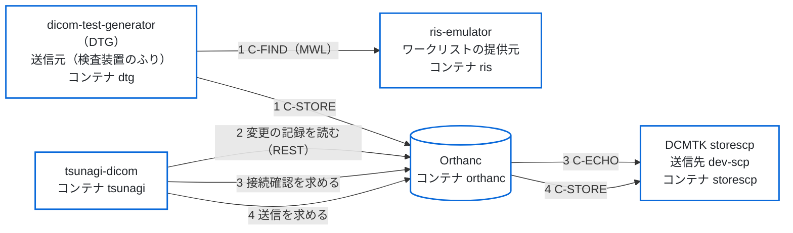

# 往復の試験の手順（受信 → 表示 → 送信）

段 4（[`spec.md`](spec.md) の 3.3・3.4）の機能を、開発用の compose（`docker/dev/compose.yaml`）で確かめる手順。開発用の compose は、配る compose（`deploy/compose.yaml`。Orthanc とセットで導入する形）の tsunagi-dicom と Orthanc に、試験用の RIS [ris-emulator](https://github.com/jeysunit/ris-emulator)（検査の予約を作り、ワークリスト（MWL）で返す）、検査装置の試験用のソフト [dicom-test-generator](https://github.com/jeysunit/dicom-test-generator)（DTG。送信元）と DCMTK の storescp（送信先）を足したもの。
クラウドの開発環境はモックだけで試す（`tests/unit/pacs-routes.test.ts`・`tests/e2e/pacs.spec.ts`・`tests/e2e/local-auth.spec.ts`）。CI では、モックの試験に加えて次の2つを流す（`.github/workflows/integration.yml`）。

- **結合の試験**（[`integration-test.md`](integration-test.md)）：この手順の 1〜7・9 を、dicom-test-generator の代わりに DCMTK の storescu で、試験の中で立てた Orthanc のコンテナに対して流す。
- **開発用の compose の流れ**（`tests/flow`）：この手順の 1・2・4・5 を、開発用の compose をそのまま立てて流す。dicom-test-generator の CLI で架空の患者を Orthanc へ送り、tsunagi-dicom の受信一覧に出ること、tsunagi-dicom から storescp へ送信し、同じ StudyInstanceUID・SOPInstanceUID の画像が同じ数だけ届くことを確かめる。予約からの流れ（ris-emulator の CLI で予約を作り、DTG がワークリストを取得してその予約で撮り、Orthanc へ送ると、tsunagi-dicom の検査の一覧に予約の StudyInstanceUID・受付番号・患者 ID で出ること）も確かめる。あわせて、Orthanc の REST（8042）がホストに公開されていないことと、内部ネットワーク（`internal: true`）に tsunagi-dicom と Orthanc だけが入っていることを確かめる。HL7 の流れ（A40、照合、照合の後の追加撮影、取消の ORM）は、下の「HL7 による患者情報の更新（PIR）」の H2・H6〜H8 に当たる。

この手順は、人が画面で確かめるときに使い、結果を PR に書く（3・6 は CI でも流すが、8 は CI では流さない）。

> **架空の患者だけで試す。** 実の患者のデータは使わない。試しの環境（架空の患者だけ）では、読む資格情報と書く資格情報を分けることを勧める（必須ではない。[`security-and-maintenance.md`](security-and-maintenance.md) の 4.1）。

## 流れ

tsunagi-dicom と Orthanc の間は内部ネットワーク `backend`（`internal: true`）、ris-emulator・DTG・storescp と Orthanc の間は DICOM のネットワーク `dicom`。Orthanc の REST はホストに公開しない（[`spec.md`](spec.md) の 5「Orthanc とセットで導入する形」）。

## 用意

1. Docker（Compose v2.24 以上。`include` と、`env_file` の `required` を使う）を入れる。
2. リポジトリの直下で `docker/dev/up.sh` を流す。次を行う。
   - secret のファイルを乱数で作る（`docker/dev/secrets/`。リポジトリに入れない。あるファイルは書き換えない）。tsunagi-dicom の `SESSION_SECRET`、Orthanc の利用者 `tsunagi` のパスワード、最初の管理者 `admin` のパスワード、DTG の Web 画面のパスワード、ris-emulator の Web 画面のパスワード（DTG と ris-emulator のパスワードのファイルは、コンテナの中の利用者（uid 10001）が読める権限にする）。
   - tsunagi-dicom のイメージを、このリポジトリから作る（`TSUNAGI_IMAGE` に GHCR のイメージを渡せば作らない）。
   - DTG と ris-emulator のイメージを、`docker/dev/compose.yaml` で固定した commit から作る（`DTG_GIT_REF`・`RIS_GIT_REF` で替えられる）。
   - 作るイメージの名前には、compose のプロジェクトの名前（`COMPOSE_PROJECT_NAME`。既定は `tsunagi-dev`）を入れる（`tsunagi-dev-tsunagi:local`・`tsunagi-dev-ris:local`・`tsunagi-dev-dtg:local`・`tsunagi-dev-dcmtk:local`）。`COMPOSE_PROJECT_NAME` とポートを替えて一式を2つ立てても、片方を作り直したときに、もう片方のイメージの名前は付け替わらない。
   - 一式を立て、起動を待ち、開く URL とパスワードのファイルの場所を出す。compose に無くなったサービスのコンテナは消す（`--remove-orphans`。ボリュームは消さない）。
   - 2026-10-21 に、dicom-test-generator の略称を DTG に直し、サービスの名前を `tdg` から `dtg` に替えた。それより前に立てた一式で `up.sh` を流し直すと、次のようになる。
     - 古い `tdg` のコンテナは消える。
     - 環境変数の名前も替えた（`DEV_TDG_WEB_PORT` は `DEV_DTG_WEB_PORT`、`TDG_GIT_REF` は `DTG_GIT_REF`）。古い名前は読まないので、指定していたときは新しい名前で指定し直す（指定し直さないと、既定のポート 18080・既定の commit に戻る）。
     - DTG の Web 画面のパスワードは、新しいファイル `dtg_web_password.txt` に作り直す（古い `tdg_web_password.txt` は使わない）。
     - DTG の状態（送信の履歴など）は、新しいボリューム（`dtg-state`・`dtg-output`）から始まる。古いボリューム（`<プロジェクト>_tdg-state`・`<プロジェクト>_tdg-output`）は残るので、要らなければ `docker volume rm` で消す。Orthanc に届いた検査（`orthanc-db`）と tsunagi-dicom のデータ（`tsunagi-data`）は、そのまま引き継ぐ。
3. 設定は次のとおり（どれもリポジトリにある）。
   - **Orthanc**：`deploy/orthanc/orthanc.json`（DICOMweb 有効・認証あり・登録した接続先からだけ C-STORE を受ける）と、`docker/dev/orthanc/site.json`（AE タイトル `ORTHANC`、接続先 `dtg`（dicom-test-generator、`DTG_CT01`）と `dev-scp`（storescp、`DEV_SCP`））。
   - **DTG**：`docker/dev/dtg/app_config.yaml`（AE タイトル `DTG_CT01`、ワークリストは ris-emulator（AE タイトル `RIS_EMU`、`ris:11112`）、送信先 `orthanc:4242`）。予約が無いときは、緊急の患者で撮る。MPPS は送らない（ris-emulator はまだ受けない）。
   - **ris-emulator**：イメージの中の設定のまま（MWL の AE タイトル `RIS_EMU`・ポート 11112。CT の予約の予定の AE タイトルは `DTG_CT01`）。Web 画面と MWL は、コンテナの中では `0.0.0.0` で待ち受ける（`RIS_WEB_BIND_ADDRESS`・`RIS_MWL_BIND_ADDRESS`）。予約は名前付きのボリューム（`ris-state`）の SQLite に残る。予約の「今日」は `TZ`（`Asia/Tokyo`。DTG と同じ）で決まる。
   - **tsunagi-dicom**：つなぎ先は `deploy/compose.yaml` が固定する（`AUTH_MODE=local`・`BACKEND_MOCK=false`・`http://orthanc:8042`）。開発用だけの設定は `docker/dev/tsunagi.env`（`MFA_REQUIRED=false`）。
4. `http://127.0.0.1:3000/` を開き、`admin` と `docker/dev/secrets/initial_admin_password.txt` のパスワードでログインし、自分のパスワード（13 文字以上・英字と数字）に変える。
5. 試す前に、管理者で `/api/audit/verify` を開き、`checked`（記録の行の数）を控える。

ポートは環境変数で替えられる：`TSUNAGI_HTTP_PORT`（既定 3000）・`ORTHANC_DICOM_PORT`（既定 4242）・`DEV_DTG_WEB_PORT`（DTG の Web 画面。既定 18080）・`DEV_RIS_WEB_PORT`（ris-emulator の Web 画面。既定 18081。利用者 `ris`）。どれもホストの 127.0.0.1 だけで待ち受ける。ris-emulator の MWL（11112）はホストに公開しない。

下の手順のコマンドは、リポジトリの直下で流す。`dc` は `docker compose -f docker/dev/compose.yaml` の略。Orthanc の REST（`/jobs` など）はホストに公開していないので、見るときは Orthanc のコンテナの中から読む。止めるときは `dc down`（volume も消して最初からにするときは `dc down --volumes`）。

## 手順と、確かめること

| # | すること | 期待すること | 控えること |
|---|---|---|---|
| 1 | DTG から Orthanc へ、架空の患者の検査を1件送る。予約から撮るときは、ris-emulator で予約を作り（`dc exec ris python -m app.cli create CT=1`。ris-emulator の Web 画面からでもよい）、DTG でワークリストを引いて（`dc exec dtg python -m app.cli worklist query`）、その予約で撮って送る：`dc exec dtg python -m app.cli exam --from-worklist KEY -s 1 -i 3 --send`（KEY はワークリストの一覧の KEY の列）。予約なしのときは、緊急の患者で送る：`dc exec dtg python -m app.cli exam --emergency --patient-id DEV0001 --patient-name "DEV^TARO" -s 1 -i 3 --send`（どちらも DTG の Web 画面からでもよい） | 送信の結果が `sent` になる。予約から撮ったときは、検査の StudyInstanceUID・受付番号・患者 ID が予約と同じ | 送った検査の患者 ID・受付番号・StudyInstanceUID・画像の数・送信元の AE タイトル（`DTG_CT01`） |
| 2 | tsunagi-dicom の「受信一覧」を開く | いちばん上の行に、送った検査が出る。時刻・送信元（1 の AE タイトル）・画像の数が合う | 出た時刻と Orthanc のサーバーの時計のずれ。送信元が空なら、Orthanc の画像のメタデータの名前（`RemoteAET`）を確かめる |
| 3 | 「接続先」を開き、`dev-scp` の「接続確認」を押す | 「成功」と出る。storescp を止めて（`dc stop storescp`）押すと「失敗」と出る。終わったら `dc start storescp` で戻す | Orthanc の C-ECHO の応答の時間 |
| 4 | 「検査一覧」で 1 の検査を選び、詳細のパネルの「送信」から `dev-scp` を選んで送る | 確認の画面に検査と送信先が出る。送ると「送信完了」になり、送信先・画像の数・時刻が出る | Orthanc のジョブの ID（`/jobs` に出る）・かかった時間 |
| 5 | storescp に届いたファイルを見る：`dc exec storescp find /received -type f`（検査の StudyInstanceUID ごとのフォルダに置かれる） | 1 と同じ検査（同じ StudyInstanceUID・画像の数）が届いている | 届いた画像の数 |
| 6 | storescp を止めてから（`dc stop storescp`）、4 をもう一度流す。終わったら `dc start storescp` | 「送信失敗」と、Orthanc のエラーの文言が出る | 出たエラーの番号と文言 |
| 7 | **受けた後に応答が失われたとき**：tsunagi-dicom と Orthanc の間の入口（リバースプロキシ）の応答を待つ時間を短くして（例：1 秒）、4 を流す。開発用の compose には入口が無いので、結合の試験（[`integration-test.md`](integration-test.md) の 8）で CI が毎回流す | Orthanc はジョブを受けて送信先へ送るが、画面は「送信結果を確認できません」と要求ID を出し、「送信」は押せない。新しく送ろうとしても、同じ検査・同じ送信先は断られる | Orthanc の `/jobs` にジョブができたか、storescp に届いたか。届いていれば、管理者が「送信済みとして記録」すると、操作ログに `reconcile` の行が足されること。入口の待つ時間は元に戻す |
| 8 | **操作ログが書けないとき**：試しの環境だけで、tsunagi-dicom の `/data` を読み取りだけにしてから、4 を流す（施設の本番の環境では行わない） | 「求めた」を記録できないので、Orthanc を呼ばずにエラーになる（Orthanc の `/jobs` にジョブができない・storescp に届かない） | Orthanc の `/jobs` に新しいジョブが無いこと。`/data` を戻してから、9 で記録のつなぎが壊れていないこと |
| 9 | 管理者で `/api/audit/verify` を開く | `ok` が `true`。`checked` が 4 の手順の前より増えている | 増えた行の数。送るの記録が、要求の ID で「求めた」「結果」「終わり」の3行（7 の送信は「求めた」「結果（unknown）」「照らした」）につながっていること |

## ビューアで開く

開発用の compose には、Orthanc の OHIF と Stone Web Viewer の plugin（`OHIF_PLUGIN_ENABLED`・`STONE_WEB_VIEWER_PLUGIN_ENABLED`。`docker/dev/viewer.override.yaml`）と、ホストの `127.0.0.1:18042`（`DEV_VIEWER_PORT`）に出す読み取り専用の入口 `viewer-proxy` が入っている。入口は GET と HEAD だけを Orthanc に通し、書き込みの方法は 405 で断る（Orthanc の REST そのものはホストに出さない）。tsunagi-dicom の `VIEWER_OHIF_URL`・`VIEWER_STONE_URL` はこの入口の `/ohif`・`/stone-webviewer` を指すので、検査一覧の「開く」が別のタブで `/ohif/viewer?StudyInstanceUIDs=…` を開く。ビューアは Orthanc の DICOMweb から直に画像を取り、Orthanc の認証（Basic。利用者 `tsunagi`、パスワードは `docker/dev/secrets/backend_password.txt`）をブラウザが聞く。

| # | すること | 期待すること |
|---|---|---|
| V1 | 1 で送った検査を「検査一覧」で選び、「開く」を押す | 別のタブで OHIF が開く（Orthanc の認証を聞かれたら 上の利用者で入る）。画像が出る。操作ログに `open_viewer` の行が足される |
| V2 | 「開く」の ▾ から Stone で開く | 別のタブで Stone が開く。画像が出る |

CI の流れの試験（`tests/flow` の 1b）は、入口が認証なしで 401、認証つきで OHIF・Stone の画面に 200、書き込みの方法に 405 を返すことまでを確かめる。画像が出ることは人が確かめる。

## HL7 による患者情報の更新（PIR）

ris-emulator が HL7 v2.3.1 で送る患者の統合（A40）・属性の更新（A08）・予約（ORM）を、受け口 `hl7-receiver` が受け、tsunagi-dicom が Orthanc の検査を書き換える（[`spec.md`](spec.md) の 3.5「HL7 による患者情報の更新」）。受け口は ris-emulator だけと共有するネットワークの中で待ち受け、ホストには出していない。

| # | すること | 期待すること |
|---|---|---|
| H1 | 緊急の患者で撮って送る：`dc exec dtg python -m app.cli exam --emergency --patient-id DEV0001 --patient-name "DEV^TARO" -s 2 -i 2,2 --send` | 患者 ID `DEV0001`、受付番号が空の検査が 1 件できる |
| H2 | 正式な患者に統合する：`dc exec ris python -m app.cli pir send --host hl7-receiver --kind a40 --patient-id P000001 --prior-patient-id DEV0001 --name "TANAKA^HIROSHI=田中^博=タナカ^ヒロシ" --birth-date 19980312 --sex M` | ris-emulator が「受理されました（AA）」と出す。検査は患者 ID `P000001` と漢字・かなの氏名になり、StudyInstanceUID・SeriesInstanceUID・SOPInstanceUID は H1 と同じ。患者 ID `DEV0001` の検査は残らない |
| H3 | 氏名を直す：`dc exec ris python -m app.cli pir send --host hl7-receiver --kind a08 --patient-id P000001 --name "TANAKA^HIROSHI=田中^浩=タナカ^ヒロシ" --visit-number V20261024001` | AA。全部の画像の氏名が替わり、患者 ID・生年月日・UID と画像の数は変わらない |
| H4 | 予約（ORM の NW）を送る。ZDS に H1 の StudyInstanceUID を入れた ORM を送る（ris-emulator の照合を使わずに、ris-emulator のコンテナの中から手で組んだメッセージを送る。照合を通すときは H6） | AA。全部の画像に受付番号が入る。患者 ID の違う ORM、別の受付番号の ORM は AE で、検査は変わらない |
| H5 | tsunagi-dicom のコンテナ（`backend` のネットワーク）から受け口の 2575 につなぐ | 何も返さずに閉じる。受け口のログに `refused` が出る |
| H6 | **照合**（H1 の直後に、H2〜H4 の代わりに流す。H2〜H4 を流した検査には流さない。受付番号が重なり、患者の統合も済んでいるため）。H1 の緊急の患者の MPPS は、DTG が ris-emulator に送っている（`docker/dev/dtg/app_config.yaml` の `use_mpps`）。`dc exec ris python -m app.cli reconcile list` で撮影の SOP Instance UID を見て、`dc exec ris python -m app.cli reconcile run <SOP Instance UID> --patient-id P000001 --name "TANAKA^HIROSHI=田中^博=タナカ^ヒロシ" --birth-date 19980312 --sex M`（ris-emulator の画面の「未照合」からでもよい） | ADT^A40 と ORM^O01 が「送信完了」で、終了コードは 0。検査は H2・H4 の結果と同じになる（正式な患者 ID・氏名・生年月日・性別と、ris-emulator が付けた受付番号。UID は H1 のまま）。ris-emulator に、H1 の StudyInstanceUID の予約が完了で作られ、`reconcile list` から消える |
| H7 | **照合の後の追加撮影**（H6 の直後。IHE PIR の Case 6）。H1 と同じ仮の患者情報で、同じ検査に追加で撮って送る：`dc exec dtg python -m app.cli exam --emergency --append --study-uid <H1 の StudyInstanceUID> --patient-id DEV0001 --patient-name "DEV^TARO" -s 1 -i 2 --send` | 追加の画像は、いったん仮の患者 ID の検査として Orthanc に入る。受け口の見回し（60 秒ごと）が、届き終えた（Orthanc の `IsStable`）後に、正式な患者 ID・氏名・受付番号の検査にまとめる。一覧には同じ StudyInstanceUID の検査が 1 件だけ出て、画像の数は H1 と追加の合計。仮の患者 ID の検査は残らない |
| H8 | **取消**（H6 の直後）。照合で作った予約を取り消す：`dc exec ris python -m app.cli pir send --host hl7-receiver --kind orm --accession <H6 の受付番号> --order-control CA` | AA。検査と画像は消えず、受付番号だけが外れる（患者 ID・氏名・画像の数は変わらない）。同じ取消をもう一度送っても AA で、検査は変わらない |

H6 は `tests/flow/flow.spec.ts` の 5、H7 は 6、H8 は 7 が自動で流す。受け口が拒否したとき（AE・AR）や受け口が止まっているときは、ris-emulator の予約の詳細の「HL7 送信」に「拒否」「送信失敗」と出て、「再送信」で同じ本文を送り直せる。

### 開発の一式で測った結果（2026-10-24）

H1〜H5 を、ris-emulator の 3573572、Orthanc 1.13.0（`OverwriteInstances: true`）で流した。どれも期待どおりだった。画像は 2 シリーズ・4 枚。

- H2：4 枚とも UID の組が H1 と同じまま、患者 ID・氏名・生年月日・性別が替わった。Orthanc の中の検査の ID は替わり、元の検査は消えた。
- H3・H4：同じ Orthanc の中の ID のまま、4 枚とも値が替わった。同じ MSH-10・同じ本文の ORM を 2 回送ると、2 回とも AA で、2 回目は Orthanc を呼ばなかった。同じ MSH-10 で本文（MSH-7）の違う ORM は AR になった。
- 最初の実装では、H3 の A08 で検査が消えた。患者 ID の変わらない書き換えに `KeepSource: false` を渡したため、Orthanc が `OverwriteInstances` で置き換えた画像を、元の ID ごと消した。画像ごとの確かめが `partial` を出して後のメッセージを止めた。`KeepSource: false` を患者 ID の変わる A40 だけに直し、流し直して上の結果を得た。

### 照合（H6）を開発の一式で測った結果（2026-10-25）

ris-emulator の ae71765（照合のある版。#24 のマージ。測ったのは同じ内容の 5fe0be9）、DTG の 52380eb（`use_mpps: true`）で、`tests/flow/flow.spec.ts` の 5 を流した（compose のプロジェクトは `tsunagi-flow`）。期待どおりだった。緊急の患者（画像 2 枚）の MPPS が `reconcile list` に出て（状態は `COMPLETED`、撮影の StudyInstanceUID）、`reconcile run` の ADT^A40・ORM^O01 がどちらも AA。一覧には同じ StudyInstanceUID の検査が 1 件だけ、正式な患者 ID・生年月日・性別・受付番号・氏名（漢字）で出て、画像の数は同じ、元の患者 ID の検査は残らなかった。ris-emulator の予約は撮影の StudyInstanceUID の完了になり、`reconcile list` から消えた。

### 照合の後の追加撮影（H7）と取消（H8）を開発の一式で測った結果（2026-10-25）

ris-emulator の 3006b30（ORM の CA を送れる版。#32 のマージ）、DTG の 99eff67（`--emergency --append --study-uid` のある版。#78 のマージ）で、`tests/flow/flow.spec.ts` の 6・7 を流した（compose のプロジェクトは `tsunagi-flow`）。1〜7 の全部が通った。

- H7：照合の後に、同じ StudyInstanceUID へ仮の患者 ID・氏名のまま 2 枚（新しいシリーズ）を追加で送った。受け口の見回し（60 秒ごと）の後、一覧には同じ StudyInstanceUID の検査が 1 件だけ、正式な患者 ID・受付番号で、画像は 4 枚（照合した 2 枚と追加の 2 枚）で出て、仮の患者 ID の検査は残らなかった。追加を送ってから一覧にまとまるまで、試験の 6 全体で 1.6 分かかった（見回しの間隔と、Orthanc が画像を安定と見るまでの時間）。
- H8：照合で作った予約に CA を送ると AA。検査も画像も（2 枚）残り、受付番号だけが外れた。同じ取消をもう一度送っても AA で、検査は変わらなかった。

## 実測で決めること（段 4 の残り）

### 結合の試験で測った結果（2026-10-20）

結合の試験（[`integration-test.md`](integration-test.md)）で、`orthancteam/orthanc:26.9.1`（Orthanc 1.13.0、REST の API の版 31、DICOMweb のプラグイン 1.24）を相手に測った。送る側は DCMTK 3.6.9 の storescu、送信先は storescp。試験は CI で毎回流れ、測った値は `test-results/integration/observations.json` と CI の記録の `[itest-observation]` の行に出る。

| 項目 | 測った結果 | モックの見本・BFF の前提との違い |
|---|---|---|
| 画像のメタデータ（`/instances/{id}/metadata?expand`）の名前 | `CalledAET`・`IndexInSeries`・`MainDicomTagsSignature`・`Origin`・`PixelDataOffset`・`ReceptionDate`・`RemoteAET`・`RemoteIP`・`SopClassUid`・`TransferSyntax` | 見本（`made/instance-metadata.json`）の 5 つ（`CalledAET`・`Origin`・`ReceptionDate`・`RemoteAET`・`TransferSyntax`）は名前も形も合う。名前は `RemoteAET`（BFF が先に読む名前）。見本に無い名前は BFF が読まないので、違いにならない |
| メタデータの値 | C-STORE で受けた画像は `Origin` が `DicomProtocol`、`RemoteAET` が送ってきた側の AE タイトル、`CalledAET` が Orthanc の AE タイトル。`ReceptionDate` は `YYYYMMDDTHHMMSS` | 見本と合う |
| `/changes` の `Date` と `ReceptionDate` の時間帯 | UTC（時間帯の印なし）。Orthanc のコンテナの時間帯を `Asia/Tokyo`（`+0900`）にしても UTC のまま | [`spec.md`](spec.md) の 3.3 の「Date は UTC」と合う。いまの BFF の `receivedAt` は印なしで返り、頁は UTC の時刻をそのまま出す（3.3 の、`Z` つきで返して `TZ` に直す直しは別の PR で行う。試験は印なしと `Z` つきの両方を受ける） |
| `/changes?last` | 最後の変更 1 件を返す（名前は `Changes`・`Done`・`First`・`Last`。`Done` は `true`） | BFF が使う `Last` は合う。`First` は見本に無いが、BFF は読まない |
| `/changes` が 1 回に返す数 | `since=0&limit=1000` で、全部の 155 件を 1 回で返した（`Done` は `true`）。100 件では切り詰めない | BFF は 100 件ずつ求めて `Last` から続けて読むので、どちらでも抜けない。1000 件を超えたときの上限は測っていない |
| `/studies/{id}/series` | シリーズごとに `Instances`（画像の ID の並び）を返す | BFF の読み方の前提と合う |
| 送るの非同期の答え（`POST /modalities/{id}/store`、`Synchronous: false`） | `ID` と `Path` | BFF は `ID` だけを読む。合う |
| 送るの仕事の状態の移り方 | 画像 120 枚の送るで `Running` → `Success`（空いた Orthanc では `Pending` を読めなかった） | モックは `Pending` → `Running` → `Success`。実では `Pending` を飛ばすことがあるが、画面は `Pending` が無くても終わりまで出す（試験の 4 で確かめた） |
| 仕事の JSON の名前 | `CompletionTime`・`Content`・`CreationTime`・`EffectiveRuntime`・`ErrorCode`・`ErrorDescription`・`ErrorDetails`・`ID`・`Priority`・`Progress`・`State`・`Timestamp`・`Type`。`Content` は `Description`・`FailedInstancesCount`・`InstancesCount`・`LocalAet`・`ParentResources`・`RemoteAet`・`Resources` | BFF が読む名前（`ID`・`State`・`Progress`・`ErrorCode`・`ErrorDescription`・`CreationTime`・`CompletionTime`）はある |
| 成功のとき | `ErrorCode` 0、`ErrorDescription` は `Success` | モックと合う |
| 送信先が止まっているとき | `State` が `Failure`、`ErrorCode` 9、`ErrorDescription` は `Error in the network protocol`、`ErrorDetails` に送信先へつなげなかった理由（送信先の名前を引けない） | モックの見本（`ErrorCode` 9・`Error in the network protocol`）と合う。BFF は `ErrorDetails` を画面に返さない |
| C-ECHO が通らないとき | Orthanc は 500 と、誤りの JSON（`Details`・`HttpError`・`HttpStatus`・`Message`・`Method`・`OrthancError`・`OrthancStatus`・`Uri`）を返す | BFF の前提（500 を「つながらない」と読む）と合う |
| 書き出し（`/studies/{id}/archive`） | 画像の数だけの DICOM のファイルの ZIP（患者・検査・シリーズのフォルダの下）。ほかのファイルは無い | 合う |
| 受けた後に答えが失われたとき（上の手順 7） | 入口が 504 を返しても、Orthanc は仕事を作って送信先へ送る | BFF の結果不明の扱い（[`spec.md`](spec.md) の 3.5）の前提と合う |

### 結合の試験で測った結果（2026-10-21）

同じ版の Orthanc を相手に、結合の試験の 13 で測った。

| 項目 | 測った結果 | BFF の前提との違い |
|---|---|---|
| QIDO-RS の検査の検索を `limit` で切ったときの順（検査 1007 件、`limit=1000`） | 1000 件を返した。検査日の新しい順でも古い順でもなかった。2 回流して、並びは 2 回とも違った（先頭の 3 件の検査日は、1 回目が 2021-11-25・2021-12-03・2020-06-29、2 回目が 2021-04-15・2021-06-08・2021-02-18。検査の UID は流すたびに作り直す）。最後に入れたいちばん新しい検査は、2 回とも 1000 件の中にあった | 規格（PS3.18 8.3.4.4）は順を決めていない。BFF は `limit` の答えを「新しい順の 1000 件」とみなさず、検査日の範囲で区切って問い合わせ直す（[`spec.md`](spec.md) の 3.1「上限に届いたとき」） |
| 続きがあるときの `Warning: 299` | 付けなかった（`limit=1000` でも `limit=1001` でも） | 規格は付けるとする（8.3.4.4.1）。BFF は `Warning` が無くても、返した数が求めた数（上限＋1）に届いたら「続きがある」と読む |
| `limit=1001` | 1001 件を返した（Orthanc の側で 1000 件などに切り詰めない） | BFF は上限＋1 を求めて「続きがある」かを見る前提と合う。画像サーバーが求めた数より少なく切り詰めて、`Warning` も付けないと、続きがあることを知る手段が無い |

### 結合の試験で測った結果（2026-10-23）

同じ版の Orthanc を相手に、結合の試験の 14 で測った。

| 項目 | 測った結果 | BFF の前提との違い |
|---|---|---|
| SpecificCharacterSet が `\ISO 2022 IR 87` の画像の WADO-RS の `metadata` | 氏名は `Alphabetic` が `ITEST^HANAKO`、`Ideographic` が `試験^花子`、`Phonetic` が `しけん^はなこ`。検査名は `頭部単純`。どれも Unicode に直して返した。`00080005` の値は `["ISO 2022 IR 87"]`（先頭の空の値を落とした 1 つ） | BFF は文字コードを読み替えず、受けた文字をそのまま返す前提と合う。答えの写しは `tests/fixtures/orthanc/dicom-web/iso2022-instance-metadata.json` |
| WADO-RS の `metadata` のファイルのメタ情報（転送構文 (0002,0010)） | 入っていなかった | 既定の主なタグに入れていない前提と合う。施設が `INSTANCE_TAGS` に足すと、値は「—」になる |

### 結合の試験で見つけて直した、BFF の食い違い

結合の試験の 10 で見つけ、PR #33 で直した（いまは結合の試験の 10 が緑）。

- **サムネイルが出なかった。** 一覧と詳細の `` がブラウザの既定の Accept（`image/avif,image/webp,…,image/*,*/*;q=0.8`）のまま中継（`/api/dicom-web/…/thumbnail`）を通ると、DICOMweb のプラグインは 400（`Unsupported MIME type in WADO-RS rendered frame`）を返していた。`Accept: image/jpeg` なら 200 で JPEG を返す。モックはサムネイルの見本の PNG を Accept に依らず返すので、モックの試験では見えなかった。直し方：中継が `thumbnail`・`rendered` の要求に限って、Orthanc へ送る Accept を BFF が決める。
- **書き出しの「結果」の行が操作ログに残らなかった。** ZIP は流れ切るが、操作ログには「求めた」の行だけが残り、BFF のログに `export_result_not_recorded` が出ていた。本文を流し終えたときに書く記録（`src/app/api/studies/[uid]/export/route.ts` の `watchedBody`）が、`audit()` の中で要求のヘッダー（`headers()`）を読むが、応答を返した後なので読めずに失敗していた。直し方：送信元をルートの中で先に読んでおき、流し終えたときはそれを使って書く。

### まだ測っていないこと

- 接続先の数が多いとき・受信一覧の件数が多いときの、画面の応答の時間。
- `/changes` が 1 回に返す数の上限（1000 件を超えたとき）。
- 施設の環境に近い Orthanc（データベースの差し替え・入口のリバースプロキシ・TLS）での、上の結果の違い。

結果は、段 4 の PR に書く（どの Orthanc の版で、何が期待どおりで、何が違ったか）。施設の内部の名前・住所は書かない。
