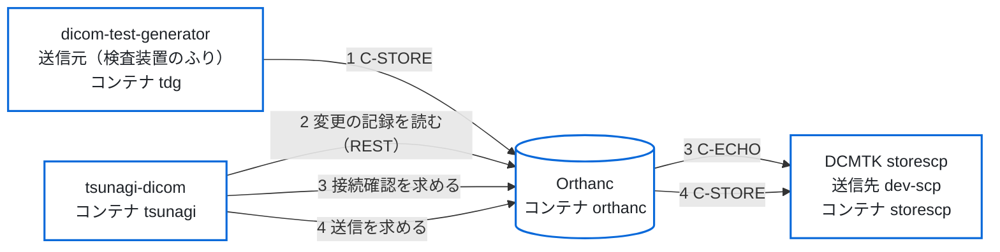

# 往復の試験の手順（受信 → 表示 → 送信）

段 4（[`spec.md`](spec.md) の 3.3・3.4）の機能を、開発用の compose（`docker/dev/compose.yaml`）で確かめる手順。開発用の compose は、配る compose（`deploy/compose.yaml`。Orthanc とセットで導入する形）の tsunagi-dicom と Orthanc に、検査装置の試験用のソフト [dicom-test-generator](https://github.com/jeysunit/dicom-test-generator)（送信元）と DCMTK の storescp（送信先）を足したもの。
クラウドの開発環境はモックだけで試す（`tests/unit/pacs-routes.test.ts`・`tests/e2e/pacs.spec.ts`・`tests/e2e/local-auth.spec.ts`）。CI では、モックの試験に加えて次の2つを流す（`.github/workflows/integration.yml`）。

- **結合の試験**（[`integration-test.md`](integration-test.md)）：この手順の 1〜7・9 を、dicom-test-generator の代わりに DCMTK の storescu で、試験の中で立てた Orthanc のコンテナに対して流す。
- **開発用の compose の流れ**（`tests/flow`）：この手順の 1・2・4・5 を、開発用の compose をそのまま立てて流す。dicom-test-generator の CLI で架空の患者を Orthanc へ送り、tsunagi-dicom の受信一覧に出ること、tsunagi-dicom から storescp へ送信し、同じ StudyInstanceUID・SOPInstanceUID の画像が同じ数だけ届くことを確かめる。あわせて、Orthanc の REST（8042）がホストに公開されていないことと、内部ネットワーク（`internal: true`）に tsunagi-dicom と Orthanc だけが入っていることを確かめる。

この手順は、人が画面で確かめるときに使い、結果を PR に書く（3・6 は CI でも流すが、8 は CI では流さない）。

> **架空の患者だけで試す。** 実の患者のデータは使わない。試しの環境（架空の患者だけ）では、読む資格情報と書く資格情報を分けることを勧める（必須ではない。[`security-and-maintenance.md`](security-and-maintenance.md) の 4.1）。

## 流れ

tsunagi-dicom と Orthanc の間は内部ネットワーク `backend`（`internal: true`）、dicom-test-generator・storescp と Orthanc の間は DICOM のネットワーク `dicom`。Orthanc の REST はホストに公開しない（[`spec.md`](spec.md) の 5「Orthanc とセットで導入する形」）。

## 用意

1. Docker（Compose v2.24 以上。`include` と、`env_file` の `required` を使う）を入れる。
2. リポジトリの直下で `docker/dev/up.sh` を流す。次を行う。
   - secret のファイルを乱数で作る（`docker/dev/secrets/`。リポジトリに入れない。あるファイルは書き換えない）。tsunagi-dicom の `SESSION_SECRET`、Orthanc の利用者 `tsunagi` のパスワード、最初の管理者 `admin` のパスワード、dicom-test-generator の Web 画面のパスワード。
   - tsunagi-dicom のイメージを、このリポジトリから作る（`TSUNAGI_IMAGE` に GHCR のイメージを渡せば作らない）。
   - dicom-test-generator のイメージを、`docker/dev/compose.yaml` で固定した commit から作る（`TDG_GIT_REF` で替えられる）。
   - 一式を立て、起動を待ち、開く URL とパスワードのファイルの場所を出す。
3. 設定は次のとおり（どれもリポジトリにある）。
   - **Orthanc**：`deploy/orthanc/orthanc.json`（DICOMweb 有効・認証あり・登録した接続先からだけ C-STORE を受ける）と、`docker/dev/orthanc/site.json`（AE タイトル `ORTHANC`、接続先 `dtg`（dicom-test-generator、`DTG_CT01`）と `dev-scp`（storescp、`DEV_SCP`））。
   - **dicom-test-generator**：`docker/dev/tdg/app_config.yaml`（AE タイトル `DTG_CT01`、送信先 `orthanc:4242`）。ワークリストは無い（緊急の患者で撮る）。
   - **tsunagi-dicom**：つなぎ先は `deploy/compose.yaml` が固定する（`AUTH_MODE=local`・`BACKEND_MOCK=false`・`http://orthanc:8042`）。開発用だけの設定は `docker/dev/tsunagi.env`（`MFA_REQUIRED=false`）。
4. `http://127.0.0.1:3000/` を開き、`admin` と `docker/dev/secrets/initial_admin_password.txt` のパスワードでログインし、自分のパスワード（13 文字以上・英字と数字）に変える。
5. 試す前に、管理者で `/api/audit/verify` を開き、`checked`（記録の行の数）を控える。

ポートは環境変数で替えられる：`TSUNAGI_HTTP_PORT`（既定 3000）・`ORTHANC_DICOM_PORT`（既定 4242）・`DEV_TDG_WEB_PORT`（dicom-test-generator の Web 画面。既定 18080）。どれもホストの 127.0.0.1 だけで待ち受ける。

下の手順のコマンドは、リポジトリの直下で流す。`dc` は `docker compose -f docker/dev/compose.yaml` の略。Orthanc の REST（`/jobs` など）はホストに公開していないので、見るときは Orthanc のコンテナの中から読む。止めるときは `dc down`（volume も消して最初からにするときは `dc down --volumes`）。

## 手順と、確かめること

| # | すること | 期待すること | 控えること |
|---|---|---|---|
| 1 | dicom-test-generator から Orthanc へ、架空の患者の検査を1件送る：`dc exec tdg python -m app.cli exam --emergency --patient-id DEV0001 --patient-name "DEV^TARO" -s 1 -i 3 --send`（dicom-test-generator の Web 画面の「撮影」からでもよい） | 送信の結果が `sent` になる | 送った検査の患者 ID・StudyInstanceUID・画像の数・送信元の AE タイトル（`DTG_CT01`） |
| 2 | tsunagi-dicom の「受信一覧」を開く | いちばん上の行に、送った検査が出る。時刻・送信元（1 の AE タイトル）・画像の数が合う | 出た時刻と Orthanc のサーバーの時計のずれ。送信元が空なら、Orthanc の画像のメタデータの名前（`RemoteAET`）を確かめる |
| 3 | 「接続先」を開き、`dev-scp` の「接続確認」を押す | 「成功」と出る。storescp を止めて（`dc stop storescp`）押すと「失敗」と出る。終わったら `dc start storescp` で戻す | Orthanc の C-ECHO の応答の時間 |
| 4 | 「検査一覧」で 1 の検査を選び、詳細のパネルの「送信」から `dev-scp` を選んで送る | 確認の画面に検査と送信先が出る。送ると「送信完了」になり、送信先・画像の数・時刻が出る | Orthanc のジョブの ID（`/jobs` に出る）・かかった時間 |
| 5 | storescp に届いたファイルを見る：`dc exec storescp find /received -type f`（検査の StudyInstanceUID ごとのフォルダに置かれる） | 1 と同じ検査（同じ StudyInstanceUID・画像の数）が届いている | 届いた画像の数 |
| 6 | storescp を止めてから（`dc stop storescp`）、4 をもう一度流す。終わったら `dc start storescp` | 「送信失敗」と、Orthanc のエラーの文言が出る | 出たエラーの番号と文言 |
| 7 | **受けた後に応答が失われたとき**：tsunagi-dicom と Orthanc の間の入口（リバースプロキシ）の応答を待つ時間を短くして（例：1 秒）、4 を流す。開発用の compose には入口が無いので、結合の試験（[`integration-test.md`](integration-test.md) の 8）で CI が毎回流す | Orthanc はジョブを受けて送信先へ送るが、画面は「送信結果を確認できません」と要求ID を出し、「送信」は押せない。新しく送ろうとしても、同じ検査・同じ送信先は断られる | Orthanc の `/jobs` にジョブができたか、storescp に届いたか。届いていれば、管理者が「送信済みとして記録」すると、操作ログに `reconcile` の行が足されること。入口の待つ時間は元に戻す |
| 8 | **操作ログが書けないとき**：試しの環境だけで、tsunagi-dicom の `/data` を読み取りだけにしてから、4 を流す（施設の本番の環境では行わない） | 「求めた」を記録できないので、Orthanc を呼ばずにエラーになる（Orthanc の `/jobs` にジョブができない・storescp に届かない） | Orthanc の `/jobs` に新しいジョブが無いこと。`/data` を戻してから、9 で記録のつなぎが壊れていないこと |
| 9 | 管理者で `/api/audit/verify` を開く | `ok` が `true`。`checked` が 4 の手順の前より増えている | 増えた行の数。送るの記録が、要求の ID で「求めた」「結果」「終わり」の3行（7 の送信は「求めた」「結果（unknown）」「照らした」）につながっていること |

## 実測で決めること（段 4 の残り）

### 結合の試験で測った結果（2026-10-20）

結合の試験（[`integration-test.md`](integration-test.md)）で、`orthancteam/orthanc:26.9.1`（Orthanc 1.13.0、REST の API の版 31、DICOMweb のプラグイン 1.24）を相手に測った。送る側は DCMTK 3.6.9 の storescu、送り先は storescp。試験は CI で毎回流れ、測った値は `test-results/integration/observations.json` と CI の記録の `[itest-observation]` の行に出る。

| 項目 | 測った結果 | モックの見本・BFF の前提との違い |
|---|---|---|
| 画像のメタデータ（`/instances/{id}/metadata?expand`）の名前 | `CalledAET`・`IndexInSeries`・`MainDicomTagsSignature`・`Origin`・`PixelDataOffset`・`ReceptionDate`・`RemoteAET`・`RemoteIP`・`SopClassUid`・`TransferSyntax` | 見本（`made/instance-metadata.json`）の 5 つ（`CalledAET`・`Origin`・`ReceptionDate`・`RemoteAET`・`TransferSyntax`）は名前も形も合う。名前は `RemoteAET`（BFF が先に読む名前）。見本に無い名前は BFF が読まないので、違いにならない |
| メタデータの値 | C-STORE で受けた画像は `Origin` が `DicomProtocol`、`RemoteAET` が送ってきた側の AE タイトル、`CalledAET` が Orthanc の AE タイトル。`ReceptionDate` は `YYYYMMDDTHHMMSS` | 見本と合う |
| `/changes` の `Date` と `ReceptionDate` の時間帯 | UTC（時間帯の印なし）。Orthanc のコンテナの時間帯を `Asia/Tokyo`（`+0900`）にしても UTC のまま | [`spec.md`](spec.md) の 3.3 の「Date は UTC」と合う。いまの BFF の `receivedAt` は印なしで返り、頁は UTC の時刻をそのまま出す（3.3 の、`Z` つきで返して `TZ` に直す直しは別の PR で行う。試験は印なしと `Z` つきの両方を受ける） |
| `/changes?last` | 最後の変更 1 件を返す（名前は `Changes`・`Done`・`First`・`Last`。`Done` は `true`） | BFF が使う `Last` は合う。`First` は見本に無いが、BFF は読まない |
| `/changes` が 1 回に返す数 | `since=0&limit=1000` で、全部の 155 件を 1 回で返した（`Done` は `true`）。100 件では切り詰めない | BFF は 100 件ずつ求めて `Last` から続けて読むので、どちらでも抜けない。1000 件を超えたときの上限は測っていない |
| `/studies/{id}/series` | シリーズごとに `Instances`（画像の ID の並び）を返す | BFF の読み方の前提と合う |
| 送るの非同期の答え（`POST /modalities/{id}/store`、`Synchronous: false`） | `ID` と `Path` | BFF は `ID` だけを読む。合う |
| 送るの仕事の状態の移り方 | 画像 120 枚の送るで `Running` → `Success`（空いた Orthanc では `Pending` を読めなかった） | モックは `Pending` → `Running` → `Success`。実では `Pending` を飛ばすことがあるが、画面は `Pending` が無くても終わりまで出す（試験の 4 で確かめた） |
| 仕事の JSON の名前 | `CompletionTime`・`Content`・`CreationTime`・`EffectiveRuntime`・`ErrorCode`・`ErrorDescription`・`ErrorDetails`・`ID`・`Priority`・`Progress`・`State`・`Timestamp`・`Type`。`Content` は `Description`・`FailedInstancesCount`・`InstancesCount`・`LocalAet`・`ParentResources`・`RemoteAet`・`Resources` | BFF が読む名前（`ID`・`State`・`Progress`・`ErrorCode`・`ErrorDescription`・`CreationTime`・`CompletionTime`）はある |
| 成功のとき | `ErrorCode` 0、`ErrorDescription` は `Success` | モックと合う |
| 送り先が止まっているとき | `State` が `Failure`、`ErrorCode` 9、`ErrorDescription` は `Error in the network protocol`、`ErrorDetails` に送り先へつなげなかった理由（送り先の名前を引けない） | モックの見本（`ErrorCode` 9・`Error in the network protocol`）と合う。BFF は `ErrorDetails` を画面に返さない |
| C-ECHO が通らないとき | Orthanc は 500 と、誤りの JSON（`Details`・`HttpError`・`HttpStatus`・`Message`・`Method`・`OrthancError`・`OrthancStatus`・`Uri`）を返す | BFF の前提（500 を「つながらない」と読む）と合う |
| 書き出し（`/studies/{id}/archive`） | 画像の数だけの DICOM のファイルの ZIP（患者・検査・シリーズのフォルダの下）。ほかのファイルは無い | 合う |
| 受けた後に答えが失われたとき（上の手順 7） | 入口が 504 を返しても、Orthanc は仕事を作って送り先へ送る | BFF の結果不明の扱い（[`spec.md`](spec.md) の 3.5）の前提と合う |

### 結合の試験で見つけて直した、BFF の食い違い

結合の試験の 10 で見つけ、PR #33 で直した（いまは結合の試験の 10 が緑）。

- **サムネイルが出なかった。** 一覧と詳細の `` がブラウザの既定の Accept（`image/avif,image/webp,…,image/*,*/*;q=0.8`）のまま中継（`/api/dicom-web/…/thumbnail`）を通ると、DICOMweb のプラグインは 400（`Unsupported MIME type in WADO-RS rendered frame`）を返していた。`Accept: image/jpeg` なら 200 で JPEG を返す。モックはサムネイルの見本の PNG を Accept に依らず返すので、モックの試験では見えなかった。直し方：中継が `thumbnail`・`rendered` の要求に限って、Orthanc へ送る Accept を BFF が決める。
- **書き出しの「結果」の行が操作ログに残らなかった。** ZIP は流れ切るが、操作ログには「求めた」の行だけが残り、BFF のログに `export_result_not_recorded` が出ていた。本文を流し終えたときに書く記録（`src/app/api/studies/[uid]/export/route.ts` の `watchedBody`）が、`audit()` の中で要求のヘッダー（`headers()`）を読むが、応答を返した後なので読めずに失敗していた。直し方：送信元をルートの中で先に読んでおき、流し終えたときはそれを使って書く。

### まだ測っていないこと

- 接続先の数が多いとき・受信一覧の件数が多いときの、画面の応答の時間。
- `/changes` が 1 回に返す数の上限（1000 件を超えたとき）。
- 施設の環境に近い Orthanc（データベースの差し替え・入口のリバースプロキシ・TLS）での、上の結果の違い。

結果は、段 4 の PR に書く（どの Orthanc の版で、何が期待どおりで、何が違ったか）。施設の内部の名前・住所は書かない。
