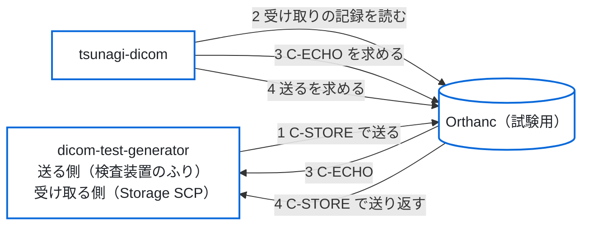

# 往復の試験の手順（受け取る → 見る → 送り返す）

段 4（[`spec.md`](spec.md) の 3.3・3.4）の機能を、実の Orthanc と、検査装置の試験用のソフト [dicom-test-generator](https://github.com/jeysunit/dicom-test-generator) で確かめる手順。
CI とクラウドの開発環境はモックだけで試す（`tests/unit/pacs-routes.test.ts`・`tests/e2e/pacs.spec.ts`・`tests/e2e/local-auth.spec.ts`）。この手順は、実の Orthanc につなげる環境で人が行い、結果を PR に書く。

> **架空の患者だけで試す。** 実の患者のデータは使わない。試しの環境（架空の患者だけ）では、読む資格情報と書く資格情報を分けることを勧める（必須ではない。[`security-and-maintenance.md`](security-and-maintenance.md) の 4.1）。

## 流れ

## 用意

1. **Orthanc**：DICOMweb のプラグインを有効にする。dicom-test-generator の受け取る側を、送り先の機器として登録する（例：Orthanc の設定の `DicomModalities` に `"dtg": ["DTG_SCP", "192.0.2.20", 11112]`。名前・AE タイトル・住所は環境の値にする）。dicom-test-generator からの C-STORE を受けられるようにする（受け元の確かめは Orthanc の設定で、施設の決まりに従う）。
   - REST で機器を足したときは、Orthanc の記憶の中だけにあり、再起動で消える（`DicomModalitiesInDatabase` を `true` にすると残る）。
2. **dicom-test-generator**：`config/app_config.yaml` の `storage_scp:` を `enabled: true` にして、受け取る側を起こす（`python -m app.cli scp start`）。既定は手元（127.0.0.1）だけで待ち受けるので、Orthanc から届く住所で待ち受けるように設定する。C-ECHO には Success を返す。
3. **tsunagi-dicom**：`AUTH_MODE=local`、`BACKEND_MOCK=false`、`BACKEND_ORTHANC_URL`（Orthanc の REST）と `BACKEND_DICOMWEB_URL`（Orthanc の DICOMweb のプラグイン）を設定する。書く資格情報を分けるときは `BACKEND_WRITE_USERNAME`・`BACKEND_WRITE_PASSWORD_FILE` も渡す。管理者か技師の利用者でログインする。
4. 試す前に、管理者で `/api/audit/verify` を開き、`checked`（記録の行の数）を控える。

## 手順と、確かめること

| # | すること | 期待すること | 控えること |
|---|---|---|---|
| 1 | dicom-test-generator から Orthanc へ、架空の患者の検査を1件送る | dicom-test-generator の側で送れたと出る | 送った検査の患者 ID・StudyInstanceUID・画像の数・送った側の AE タイトル |
| 2 | tsunagi-dicom の「受け取り」を開く | いちばん上の行に、送った検査が出る。時刻・送ってきた機器（1 の AE タイトル）・画像の数が合う | 出た時刻と Orthanc のサーバーの時計のずれ。送ってきた機器が空なら、Orthanc の画像のメタデータの名前（`RemoteAET`）を確かめる |
| 3 | 「機器」を開き、`dtg` の「確かめる」を押す | 「つながった」と出る。dicom-test-generator を止めて押すと「つながらない」と出る | Orthanc の C-ECHO の答えの時間 |
| 4 | 「検査」で 1 の検査を選び、詳細のパネルの「送る」から `dtg` を選んで送る | 確かめの画面に検査と送り先が出る。送ると「送る順を待っている」→「送っている」→「送った」と進む | Orthanc の仕事の ID（`/jobs` に出る）・かかった時間 |
| 5 | dicom-test-generator の受け取る側の記録を見る | 1 と同じ検査（同じ StudyInstanceUID・画像の数）が届いている | 届いた画像の数 |
| 6 | dicom-test-generator を止めてから、4 をもう一度流す | 「送れなかった」と、Orthanc の誤りの文言が出る | 出た誤りの番号と文言 |
| 7 | **受けた後に答えが失われたとき**：tsunagi-dicom と Orthanc の間の入口（リバースプロキシ）の答えを待つ時間を短くして（例：1 秒）、4 を流す | Orthanc は仕事を受けて送り先へ送るが、画面は「結果が分からない」と要求の ID を出し、「送る」は押せない。新しく送ろうとしても、同じ検査・同じ送り先は断られる | Orthanc の `/jobs` に仕事ができたか、dicom-test-generator に届いたか。届いていれば、管理者が「送り先で確かめた内容」を書いて「届いていた」を押し、記録に `reconcile` の行が足されること。入口の待つ時間は元に戻す |
| 8 | **監査の記録が書けないとき**：試しの環境だけで、tsunagi-dicom の `/data` を読み取りだけにしてから、4 を流す（施設の本番の環境では行わない） | 「求めた」を記録できないので、Orthanc を呼ばずに誤りになる（Orthanc の `/jobs` に仕事ができない・dicom-test-generator に届かない） | Orthanc の `/jobs` に新しい仕事が無いこと。`/data` を戻してから、9 で記録のつなぎが壊れていないこと |
| 9 | 管理者で `/api/audit/verify` を開く | `ok` が `true`。`checked` が 4 の手順の前より増えている | 増えた行の数。送るの記録が、要求の ID で「求めた」「結果」「終わり」の3行（7 の送信は「求めた」「結果（unknown）」「照らした」）につながっていること |

## 実測で決めること（段 4 の残り）

- 画像のメタデータの `Origin`・`ReceptionDate`・`CalledAET` の名前と値（[`spec.md`](spec.md) の 3.3）。違えば、モックの見本（`tests/fixtures/orthanc/made/instance-metadata.json`）と BFF の読み方を直す。
- `/changes?last` が最後の番号を返すか、`/changes` が 1 回に返す数の上限（BFF は 100 件を求め、答えの `Last` から続けて `Done` まで読むので、上限が小さくても抜けないが、読む回数が増える）、`/studies/{id}/series` がシリーズの中身を返すか（BFF の読み方の前提）。
- 送るの仕事の状態の移り方と、失敗のときの `ErrorCode`・`ErrorDescription` の値。
- 送り先の機器の数が多いとき・受け取りの記録が多いときの、画面の答えの時間。

結果は、段 4 の PR に書く（どの Orthanc の版で、何が期待どおりで、何が違ったか）。施設の内部の名前・住所は書かない。
