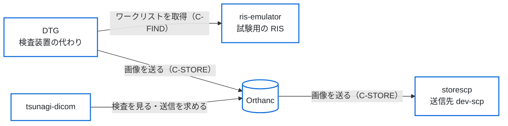

# 開発用の一式で、予約から送信までを試す

この文書は、開発用の一式（`docker/dev/compose.yaml`）を手元に立て、検査の予約から送信までを画面で一通り試す手順である。試験用の RIS（ris-emulator）で検査の予約を作り、検査装置の代わりのソフト（dicom-test-generator。以下 DTG）でその予約を撮って Orthanc へ送る。届いた検査を tsunagi-dicom で確かめ、tsunagi-dicom から送信先（DCMTK の storescp）へ送る。

使うのは架空の患者だけで、本物の患者のデータは入れない。施設の画像サーバーや RIS にはつながない。

## 一式の構成

一式は、Docker のコンテナ5つでできている。



| コンテナ | 役割 |
|---|---|
| ris-emulator | 検査の予約を作り、ワークリスト（MWL）で返す（[ris-emulator](https://github.com/jeysunit/ris-emulator)） |
| DTG | ワークリストの予約（または予約の無い緊急の患者）で試験用の画像を作り、Orthanc へ送る（[dicom-test-generator](https://github.com/jeysunit/dicom-test-generator)） |
| Orthanc | 画像を受けて保存する |
| tsunagi-dicom | このリポジトリのアプリ。Orthanc の検査を見て、ほかの機器へ送る |
| storescp | tsunagi-dicom から送った画像を受ける（DCMTK） |

## 一式を立てる

Docker と Docker Compose（v2.24 以上）を入れ、リポジトリの直下で次の1行を流す。

```sh
docker/dev/up.sh
```

`up.sh` は、次の3つを行う。

1. パスワードなどの秘密のファイルを乱数で作る（`docker/dev/secrets/`。リポジトリには入れない。あるファイルは書き換えない）。
2. tsunagi-dicom のイメージをこのリポジトリから作る。
3. `docker compose up` で一式を立て（ris-emulator・DTG・storescp のイメージもここで作る）、起きるのを待ってから、開く URL とパスワードのファイルの場所を出す。

画面とパスワードのファイルは次のとおり。どれもホストの 127.0.0.1 だけで待ち受ける。

| 画面 | URL | 利用者 | パスワードのファイル |
|---|---|---|---|
| tsunagi-dicom | <http://127.0.0.1:3000/> | `admin` | `docker/dev/secrets/initial_admin_password.txt`（最初のログインで、自分のパスワード（13 文字以上・英字と数字）に変える） |
| ris-emulator | <http://127.0.0.1:18081/> | `ris` | `docker/dev/secrets/ris_web_password.txt` |
| DTG | <http://127.0.0.1:18080/> | `dtg` | `docker/dev/secrets/dtg_web_password.txt` |

Orthanc は、DICOM の受け口（`127.0.0.1:4242`、AE タイトル `ORTHANC`）だけをホストに出している。ポートがほかのソフトとぶつかるときは、`TSUNAGI_HTTP_PORT`・`ORTHANC_DICOM_PORT`・`DEV_DTG_WEB_PORT`・`DEV_RIS_WEB_PORT` を付けて `up.sh` を流す。

一式に登録してある AE タイトルと設定のファイルは次のとおり。

| 機器 | AE タイトル | 設定のファイル |
|---|---|---|
| DTG | `DTG_CT01`（ris-emulator の CT の予約の、予定の AE タイトルと同じ） | `docker/dev/dtg/app_config.yaml` |
| ris-emulator | `RIS_EMU` | イメージの中の設定のまま |
| storescp | `DEV_SCP`（Orthanc では送信先 `dev-scp`） | `docker/dev/orthanc/site.json`（Orthanc に登録する接続先） |

この文書のコマンドは、リポジトリの直下で流す。`dc` は `docker compose -f docker/dev/compose.yaml` の略で、先に次の1行を流しておくとそのまま使える。

```sh
alias dc='docker compose -f docker/dev/compose.yaml'
```

一式を止めるときは `dc down`、届いた検査も消して最初からにするときは `dc down --volumes` を流す。

## 手順

画面での操作を主に書き、同じことを CLI で行うときのコマンドを各段に添える。

### 1. ris-emulator で検査の予約を作る

ris-emulator の画面の「予約を作る」で、CT に 1 件を入れて「予約を作る」を押す。予定日は今日のままにする。

- 確かめること：「予約の一覧」に、状態が「予定」の予約が出る。受付番号を控える。
- CLI：`dc exec ris python -m app.cli create CT=1`

### 2. DTG でワークリストを取得し、撮影して送る

DTG の画面のワークリストで「ワークリストを取得」を押し、1 の予約を選んで「選んで撮影へ」を押す。撮影の画面で「撮影して送る」を押す。

- 確かめること：「撮影完了」と画像の数が出て、送信の状態が「送信完了」になる。
- CLI：`dc exec dtg python -m app.cli worklist query` で予約の KEY を見て、`dc exec dtg python -m app.cli exam --from-worklist <KEY> -s 1 -i 3 --send` を流す。

予約を作らずに試すときは、DTG の撮影の画面の「緊急の患者（予約なし）」で撮る（CLI では `dc exec dtg python -m app.cli exam --emergency --patient-id DEV0001 --patient-name "DEV^TARO" -s 1 -i 3 --send`）。

### 3. tsunagi-dicom で、届いた検査を確かめる

tsunagi-dicom にログインし、「受信一覧」と「検査一覧」を開く。

- 確かめること：「受信一覧」のいちばん上に、送った検査が、送信元（`DTG_CT01`）と画像の数とともに出る。「検査一覧」の「詳細条件」で受付番号を入れて探すと、その検査が、1 の予約と同じ患者 ID と受付番号で出る。
- CLI：無い（画面で確かめる）。

### 4. tsunagi-dicom から storescp へ送る

「検査一覧」で 3 の検査を選び、詳細の「送信」を押す。送信先に `dev-scp` を選び、確認の画面で送る。

- 確かめること：「送信完了」と、送信先・画像の数・時刻が出る。storescp に、同じ検査の画像が同じ数だけ届いている（`dc exec storescp find /received -type f`。検査ごとのフォルダに置かれる）。
- CLI：無い（送信は画面から行う）。

### 5. ris-emulator で予約を完了にする

ris-emulator の「予約の一覧」で 1 の予約を開き、状態を「完了」にして「状態を変える」を押す。

- 確かめること：DTG でワークリストを取得し直すと、その予約が出ない（完了の予約は、ワークリストで返さない）。
- CLI：`dc exec ris python -m app.cli status <受付番号> completed`

## 送信先が止まっているとき

storescp を止めて（`dc stop storescp`）、tsunagi-dicom の振る舞いを確かめられる。

- 「接続先」で `dev-scp` の「接続確認」を押すと、「失敗」と出る。
- 4 と同じに送ると、「送信失敗」と、Orthanc の誤りの文言が出る。

確かめたら、`dc start storescp` で戻す。

## 同じ流れを自動で確かめる試験

CI の「開発用の compose の流れ」の試験（`tests/flow`）は、この一式を別の名前とポートで立て、手順に近い流れを毎回流す。ris-emulator と DTG は CLI で動かし、届いた検査は tsunagi-dicom の API で確かめる。storescp へ送るのは、予約なし（緊急の患者）で撮った検査である。手元で流す方法（`npm ci` と Chromium の用意を含む）は、[`integration-test.md`](integration-test.md) の「開発用の compose の流れ」にある。DTG の代わりに DCMTK で画像を送り、Orthanc とのつなぎを細かく確かめる結合の試験も、同じ文書にある。

## 前に立てた一式を作り直すとき

この一式を前に立てたことがあり、`up.sh` を流し直すときは、次の2つが変わる。

- 2026-10-21 に、dicom-test-generator のサービスの名前を `tdg` から `dtg` に替えた。古い `tdg` のコンテナは消え、DTG の画面のパスワードは `dtg_web_password.txt` に作り直す。ポートと版の指定は `DEV_DTG_WEB_PORT`・`DTG_GIT_REF` で行う（`DEV_TDG_WEB_PORT`・`TDG_GIT_REF` は読まない）。古いボリューム（`<プロジェクト>_tdg-state`・`<プロジェクト>_tdg-output`）は残るので、要らなければ消す。
- 監査の記録の先頭の控え（[`adr/0001-audit-chain-mac.md`](adr/0001-audit-chain-mac.md)）より前の版で立てた一式では、控えのファイルがまだ無い。置くまでは、`/api/audit/verify` が 409 を返す。控えのファイルが無いときだけ、外に残したログの控えと照らしてから、空のファイルを置く：`dc exec tsunagi touch /audit-anchors/audit-anchors.jsonl`（ファイルがあるときは、中身を消さないために置き直さない）。
