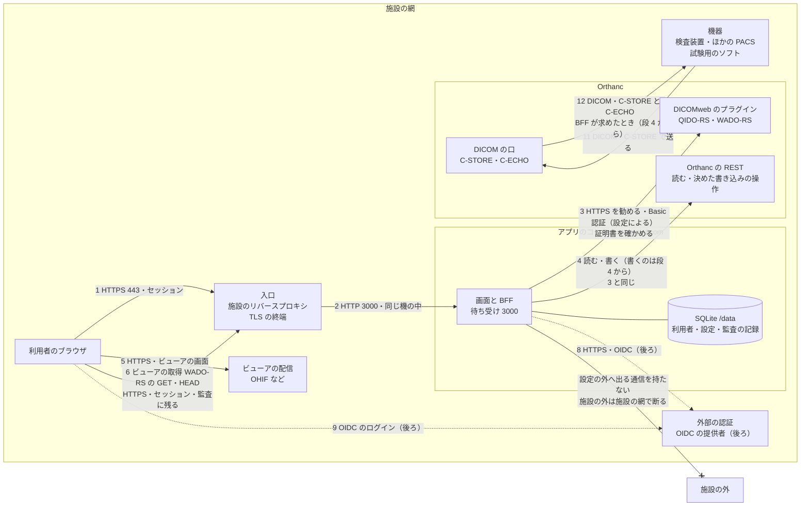

# セキュリティと保守の方針

> **医療機器としての承認・認証を受けていない。** このソフトウェアは、治験・研究・システムの試験の環境で使うためのもの（[`spec.md`](spec.md) の 0）。この文書は、施設がこのソフトウェアを置くかどうか・どう置くかを決めるための材料で、安全を保証するものではない。
>
> 状態：段 2 まで実装した（2026-10-19）。2026-10-19 に目的を「Orthanc 専用の PACS の画面」に見直し、書き込みの操作（送る・書き出し・削除・取り込み・値の修正など）を段 4 から足す。まだ無い機能は予定として書き、その印（「段 X」「後ろ」）を付ける。仕様は [`spec.md`](spec.md)、厚生労働省のガイドライン（第7.0版）の項目との対応は [`guideline-mapping.md`](guideline-mapping.md)。

## 1. 方針

- **このソフトウェアが担うこと**：Orthanc の前に置く、PACS の Web の画面と中継のサーバー（BFF）。利用者の認証、役割ごとの操作と返す項目の絞り込み、ビューアが画像を取る道の中継（WADO-RS の読み取りだけ）、PACS の書き込みの操作（決めた操作ごとの Orthanc の REST を BFF から呼ぶ。段 4 から）、操作の監査の記録（前の行のハッシュをつなぐ）。
- **担わないこと**：入口の網の制御（TLS の終端・VPN・接続元の制限）、サーバーの OS とコンテナの土台の管理、Orthanc とビューアの安全（Orthanc の側の認可・機器との DICOM の通信の制御を含む）、バックアップと復旧、時計の合わせ（NTP）、端末の管理。これらは施設が行う。
- **使う場面**：治験・研究・システムの試験の環境の PACS にとどめる（[`spec.md`](spec.md) の 0）。
- **書き込みは必ず役割の確かめと監査の記録を通す。** ブラウザから Orthanc へ直に書かせない。BFF は決めた操作の REST だけを呼び、呼ぶ前に「求めた」ことを記録し、記録できなければ呼ばない（[`spec.md`](spec.md) の 3.5）。ただし、**Orthanc に直に入れる道（Orthanc の REST・Orthanc Explorer 2・DICOM の通信）は、このアプリの確かめと記録の外**にある（[4.1](#41-画像サーバーへの資格情報の形)）。
- **安全を既定にする**：設定しなければ認証が有効、証明書の確かめを切る設定を持たない、秘密に既定値を置かない、画像サーバーの資格情報をブラウザに渡さない。コンテナは root でない利用者・読み取りだけのファイルシステム・権限を落とした形で動く（`compose.yaml`）。
- **アプリが自分から外へ出る通信を持たない**：アプリが通信する先は、設定で与えた Orthanc と、後ろの外部の認証（OIDC）だけ。ほかの機器への送信（C-STORE）と疎通の確かめ（C-ECHO）は、**Orthanc が** Orthanc に登録された機器へ行う（アプリは Orthanc に求めるだけ）。版の確かめ・利用の統計などの知らせは止めてある（`NEXT_TELEMETRY_DISABLED`・`CHECKPOINT_DISABLE`）。**設定で与えた先が施設の外にあれば、その通信は外へ出る。** アプリは接続先が施設の中かを確かめないので、施設の外への通信を断るのは施設の網（コンテナの網・防火壁）で行う。アプリが設定の外へ通信しないことを CI で確かめるのは後ろ（閉じた網で動かす形と一緒に）。
- **無償の OSS で、保証は無い。** 直しを出す期間・速さは目安で、約束ではない（[6](#6-保守の方針)）。

## 2. システム構成図

勧める配置の例：施設の網の中に、入口・アプリのコンテナ・Orthanc・ビューア・機器を置き、Orthanc へは HTTPS と認証でつなぐ。点線は後ろの予定。暗号化と認証の有無が設定で変わる道は、[3 の通信の一覧](#3-通信の一覧) に条件を書く。



- 番号は [3 の通信の一覧](#3-通信の一覧) の番号。10（コンテナの中の生死の確かめ）は図から省いた。
- **ブラウザは Orthanc へ直に行かない**（既定の形）。画面の検索と PACS の操作は画面の API（1→2）、ビューアの画像の取得は BFF の中継（6→2）を通り、Orthanc へは BFF だけがつなぐ（3・4）。Orthanc の資格情報は BFF の中にだけある。
- **Orthanc とセットで導入する形**（`deploy/compose.yaml`。[`spec.md`](spec.md) の 5）では、3・4 は同じホストの中の内部ネットワーク `backend`（`internal: true`。tsunagi-dicom と Orthanc だけが入る）を通る HTTP と Basic 認証で、Orthanc の REST はホストに公開しない。ホストに公開するのは 2（画面）と 11（DICOM）だけ。Orthanc は 11・12 のために DICOM のネットワーク `dicom` にも入り、REST はその側でも待ち受ける。`dicom` はコンテナどうしの通信を止める（`enable_icc: false`）ので、足したコンテナからは届かない。**Docker のホストの上の利用者とプロセスは、Orthanc のコンテナの IP アドレスで REST に届く**（認証は要る）ので、ホストにログインできる人を絞る。11 は、登録した接続先の AE タイトルと送り元の IP アドレスの組でだけ受ける（userland-proxy を通ると送り元が変わる注意は [`spec.md`](spec.md) の 5）。
- **機器との DICOM の通信（11・12）は、Orthanc と機器の間の通信で、アプリは通らない。** アプリは、Orthanc に送信と疎通の確かめを求め（4）、受け取りの記録を読む（4）だけ。どの機器から受けるか・どの機器へ送れるかは、Orthanc の設定（登録した機器と、受け元の確かめ）で施設が決める。
- ビューアの取得先（DICOMweb の URL）を BFF の中継（`/api/dicom-web`）に向けるのは、ビューアの側の設定。ビューアごとの設定の形は段 2 で実測して決める（[`spec.md`](spec.md) の 3.2 の未決）。
- 図に無い道：研究の道具に渡す `PUBLIC_DICOMWEB_URL`（コピー用）は、研究の道具が画像サーバーへ直に行く道で、**このアプリの認可と監査の外**（通信の一覧の 7）。画像サーバーの側で認証と記録を持つ施設のためのもので、既定にしない。
- 図に無い通信：配備の時にコンテナの土台の機がイメージを GHCR から取る通信は、アプリの通信ではない。閉じた網では、イメージを持ち込む（`docker save`・`docker load`）か、施設の中のレジストリに写す。

## 3. 通信の一覧

| # | どこから → どこへ | 口 | 規格 | 認証 | 暗号化 | 備考 |
|---|---|---|---|---|---|---|
| 1 | 利用者のブラウザ → 入口 | 443（施設の決め） | HTTPS | アプリのセッション（段 1b から `AUTH_MODE=local` のログイン） | TLS（入口で終端） | TLS の版の限定・クライアント証明書・接続元の制限は入口で施設が行う |
| 2 | 入口 → 画面と BFF | 3000 | HTTP | 入口は認証しない（アプリが認証する） | 無し | `compose.yaml` の例は `127.0.0.1:3000` だけで待ち受ける（入口と同じ機に置く前提）。別の機に置くなら、その間も TLS にする |
| 3 | BFF → Orthanc（DICOMweb のプラグイン） | 施設の決め | QIDO-RS・WADO-RS | Basic 認証（`BACKEND_USERNAME`・`BACKEND_PASSWORD`）か無し | `https://` なら TLS。証明書は必ず確かめる（自前の CA は `BACKEND_CA_FILE`） | `http://` も設定できるが、同じ機の中か閉じた区画の中だけにする |
| 4 | BFF → Orthanc（REST） | 施設の決め | Orthanc の REST | 3 と同じ | 3 と同じ | 読む：件数・変更の記録・機器の一覧・仕事の状態。書く（段 4 から）：決めた操作だけ（送る・C-ECHO・書き出し・削除・取り込み・値の修正・結合と分割・機器の登録）。どれも役割の確かめと監査の記録を通す |
| 5 | 利用者のブラウザ → ビューアの配信 | 443（施設の決め） | HTTPS | 施設の決め | TLS | ビューアの安全はビューアの側（このソフトウェアは改造しない） |
| 6 | ビューア（ブラウザの中）→ BFF の中継 | 443（入口を通る） | WADO-RS の GET・HEAD | アプリのセッション（役割の確かめは段 1b） | TLS（1 と同じ入口） | 検索（QIDO-RS）は返さない。書き込み（POST・PUT・PATCH・DELETE）は 405 で断る。通したものも断ったものも監査の記録に残す |
| 7 | 研究の道具 → 画像サーバー | 施設の決め | DICOMweb | 画像サーバーの側 | 施設の決め | `PUBLIC_DICOMWEB_URL`。このアプリの監査の外。既定にしない |
| 8 | BFF → 外部の認証 | 443 | OIDC | クライアントの秘密（`OIDC_CLIENT_SECRET`） | TLS | 後ろ。つなぐ先（OSS）は作る前に決める |
| 9 | 利用者のブラウザ → 外部の認証 | 443 | OIDC | 提供者のログイン | TLS | 後ろ |
| 10 | コンテナの中の生死の確かめ → BFF | 3000（`127.0.0.1`） | HTTP（`/api/health`） | 無し | 無し | コンテナの中だけ。患者の情報も設定の値も返さず、Orthanc につながない |
| 11 | 機器 → Orthanc（DICOM の口） | 施設の決め | DICOM（C-STORE・C-ECHO） | AE タイトル（Orthanc の設定） | Orthanc の設定による | **アプリの外。** どの機器から受けるかは Orthanc の設定で施設が絞る。受け取ったことは、アプリが Orthanc の変更の記録から読んで見せる（段 4） |
| 12 | Orthanc → 機器 | 施設の決め | DICOM（C-STORE・C-ECHO） | AE タイトル（Orthanc に登録した機器） | Orthanc の設定による | アプリが求めたとき（4）に Orthanc が行う（段 4 から）。送り先は Orthanc に登録した機器だけ |
| — | アプリ → 設定で与えた先のほか | — | — | — | — | **無し。** 版の確かめ・利用の統計の知らせは止めてある。CI での確かめは後ろ。3・4・8 の先を施設の外に置けば、その通信は外へ出る（施設の網で断る）。Orthanc に施設の外の機器を登録すれば、12 は外へ出る（Orthanc の設定と施設の網で断る） |

## 4. 秘密と設定の置き場

設定の正本は [`.env.example`](../.env.example)（値は例の名前だけで、秘密は空）。要点は [`spec.md`](spec.md) の 2.1。

| 秘密 | 何のためか | 渡し方 | 既定値 |
|---|---|---|---|
| `SESSION_SECRET` | セッションの署名と、TOTP の秘密を暗号化する鍵の元（段 1b） | 値か `SESSION_SECRET_FILE`（`compose.yaml` の例は secret のファイル）。32 バイト以上の乱数 | **無し。** どちらも空なら起動しない |
| `BACKEND_PASSWORD` | BFF が画像サーバーにつなぐ資格情報 | 値か `BACKEND_PASSWORD_FILE` | 無し。`BACKEND_USERNAME` があるのにパスワードが無ければ起動しない |
| `BACKEND_WRITE_PASSWORD` | BFF が Orthanc へ書き込みの操作（POST）を求める資格情報（段 4。[4.1](#41-画像サーバーへの資格情報の形)） | 値か `BACKEND_WRITE_PASSWORD_FILE`。名前は `BACKEND_WRITE_USERNAME` | 無し。名前とパスワードの片方だけなら起動しない。両方とも無ければ読む資格情報で書く |
| `OIDC_CLIENT_SECRET` | 外部の認証のクライアントの秘密（後ろ） | 値か `OIDC_CLIENT_SECRET_FILE` | 無し |
| 利用者のパスワード | アプリのログイン（段 1b） | データベースにハッシュ（argon2id）で持つ。平文に戻せない | — |
| 最初の管理者のパスワード | 利用者が1人もいないときに、最初の管理者を作る（段 1b） | `INITIAL_ADMIN_PASSWORD_FILE` だけ（値の変数は無い）。最初のログインで本人が変える | 無し。利用者がいず、この設定も無ければ起動しない |
| TOTP の秘密 | アプリのログインの二要素（段 1b） | データベースに AES-256-GCM で暗号化して持つ。鍵は `SESSION_SECRET` から HKDF-SHA256 で導く | — |

- **同じ秘密を値と `*_FILE` の両方で渡したら起動しない**（どちらが効いているか分からなくなるため）。
- **ファイルで渡すことを勧める。** 環境変数の値は、コンテナの設定の表示（`docker inspect` など）から読める。secret のファイルはリポジトリに入れない（`secrets/` は `.gitignore`）。
- 起動の時の誤りの文言は、どの変数かだけを出し、値を出さない。
- 証明書の確かめを切る設定（`NODE_TLS_REJECT_UNAUTHORIZED=0`）を与えたら起動しない。自前の CA は `BACKEND_CA_FILE` で渡す。
- 二要素の認証（TOTP）の秘密は、`SESSION_SECRET` から導いた鍵で暗号化して持つ（段 1b。秘密のファイルを増やさないため）。**`SESSION_SECRET` を替えると、保存した TOTP の秘密は読めなくなり**、管理者が利用者ごとに「TOTP をやり直す」（[`spec.md`](spec.md) の 3.6）。監査の記録のつなぎの鍵も `SESSION_SECRET` から導くので、替えるときは前の値を `SESSION_SECRET_PREVIOUS_FILE` に残す（5 と [`adr/0001-audit-chain-mac.md`](adr/0001-audit-chain-mac.md)）。ログインのセッションの cookie には乱数の token を入れ、データベースには token の SHA-256 だけを持つ。
- **画面のロックは、既定でパスワードだけで解く**（`SCREEN_UNLOCK_REQUIRE_TOTP=false`）。画面のロックは席を外した間の覗き見・操作を防ぐもので、二要素はログインで確かめている。ロックを解くパスワードの誤りは、ログインの一時停止に数える。施設の決まりで、ロックを解くときにも TOTP が要るときは `true` にする（TOTP を登録した利用者に、パスワードと TOTP を求める）。ログインの TOTP は、この設定に関わらず求める。削除などの前の再認証は、パスワードだけで求める（2026-10-20 に承認者が決めた。TOTP を確かめないので、成功してもログインの失敗の数を消さない）。利用者の管理の前の再認証は、登録していれば TOTP も求める（パスワードとセッションだけで管理者を作り足させないため）。自分の TOTP のやり直しは断り、別の管理者が行う（[`spec.md`](spec.md) の 3.6）。
- **管理者は2人以上置く**（`AUTH_MODE=local`。段 1b）。認証のアプリを失くした利用者の TOTP は、管理者が「TOTP をやり直す」で戻すが、管理者が1人だけで、その管理者が失くしたときの道は、まだ無い（[`spec.md`](spec.md) の 3.6 の未決。後ろで決める）。最初の管理者でログインしたら、すぐ2人目の管理者を作る。

### 4.1 画像サーバーへの資格情報の形

**tsunagi-dicom は画像サーバーに、専用の機械の ID（サービスのアカウント）1つで入る。** 人の識別・認証と、誰がどの検査を開いたかの記録は、tsunagi-dicom の側で行う（第7.0版 14 遵守事項①・17 遵守事項①）。画像サーバーの側には、利用者ごとの ID は渡らない。

- **既にある利用者の資格情報を流用しない**（14 遵守事項⑥(2)）。`BACKEND_USERNAME`・`BACKEND_PASSWORD` には、この用途のために作った機械の ID だけを入れる。
- **機械の ID は施設の ID の台帳に載せ、棚卸しする**（14 遵守事項⑧）。誰が作り、何に使い、いつ見直すかは施設が決める。秘密のファイルの置き場の管理も施設が行う（4 の表）。
- **画像サーバーの側の権限は、tsunagi-dicom の作りだけに頼らない。** Orthanc の Basic 認証（`RegisteredUsers`）には、読むだけ・決めた操作だけの権限が無い。tsunagi-dicom は役割を確かめてから決めた操作だけを呼ぶ作りだが、**それだけでは 14.2（利用者ごとの権限）を画像サーバーの側で満たさない。** tsunagi-dicom が乗っ取られて機械の ID が使われると、Orthanc で、tsunagi-dicom が持たない操作（機器の書き換え・設定の変更・どの検査の削除でも）までできる。
- **段 4 から tsunagi-dicom は書き込みの操作を持つので、Orthanc の側の絞り込みの優先度が上がる。** 患者の情報を置く環境で書き込みの操作を使う前に、次のどちらかを入れる。
  - **A（本命）**：Orthanc の Authorization plugin（Orthanc の公式のプラグイン。要求ごとに外の Web の仕組みへ可否を問い合わせ、許されなければ 403 を返す。Orthanc Book の「Advanced authorization plugin」。2026-10-19 22:47 に本文を取り出して読んだ）。tsunagi-dicom の利用者・役割を Orthanc へ伝え、Orthanc の側でも役割と操作に応じて断る。問い合わせ先の Web の仕組みを誰が持つかは、作る前に決める。
  - **B（当面）**：Orthanc の前に入口（リバースプロキシなど、施設で選ぶ）を置き、資格情報ごとに通す道を絞る。**読む資格情報**には読み取り（GET・HEAD と、Orthanc の中身を変えない引き当ての `POST /tools/lookup`）だけを、**書く資格情報**には tsunagi-dicom が使う書き込みの道（[`spec.md`](spec.md) の 3.3〜3.5 に並べたもの）だけを通す。段 4 で書く資格情報が使う道は、`POST /modalities/{id}/echo`・`POST /modalities/{id}/store` の2つ。
  - 書く資格情報を渡さないときに読む資格情報で書く動き（試しの環境のため）を、患者の情報を置く環境では設定で止められるようにするか（書く資格情報が無ければ書き込みの操作を断る、など）は、承認者の判断を待つ論点として残す。
- **読む資格情報と書く資格情報を分けるか**は、置く環境で決める。
  - **患者の情報を置く環境では、分けることを必須にする**（施設の決まりとして。A でも B でも）。読む側の資格情報では、書き込みの道が通らないようにする。
  - **試しの環境（架空の患者だけを置く）では、分けることを勧める**（必須にしない）。
  - tsunagi-dicom の側は、書く資格情報を読む資格情報と別に渡せる（`BACKEND_WRITE_USERNAME`・`BACKEND_WRITE_PASSWORD`・`BACKEND_WRITE_PASSWORD_FILE`。段 4）。書く資格情報を渡さなければ、読む資格情報で書く（試しの環境のため）。tsunagi-dicom は、置かれた環境に患者の情報があるかを知らないので、分けたかどうかは施設が確かめる。
- **Orthanc に直に入れる道は、tsunagi-dicom の確かめと記録の外にある。** Orthanc の REST の口・Orthanc Explorer 2・DICOM の口（C-STORE を受ける）を使える人は、tsunagi-dicom を通らずに書き込める。施設は、Orthanc の口を tsunagi-dicom と決めた機器にだけ開く（網・入口・Orthanc の設定で）。
- **試しの環境（合成のデータだけを置く）では、専用の機械の ID 1つで足りる。** 患者の情報を置かないので、上の A・B は必須にしない。

この節は考え方を書いたもので、施設の画像サーバーの構成に対する確かめは、施設が行う。

## 5. 記録

- **監査の記録**（[`spec.md`](spec.md) の 3.6）：誰が・いつ・どの患者と検査に・何をしたを、BFF のデータベース（`/data` の SQLite）に追記だけで残す。各行は前の行のハッシュを持つ。ハッシュは鍵つきの HMAC-SHA256 で、鍵は `SESSION_SECRET` から導き、データベースには置かない（設計は [`adr/0001-audit-chain-mac.md`](adr/0001-audit-chain-mac.md)）。データベースの trigger で、更新・削除・置き換えを断る。trigger はアプリの誤りを止めるためのもので、データベースのファイルに書ける者は外せる。
- **先頭の控え**：最後の行の番号（seq）とハッシュを、起動の時と 10 分ごとに、データベースの外へ書き出す（`AUTH_MODE=local`）。書き出し先は、コンテナのログ（標準出力。`tsunagi-dicom: audit-anchor {…}` の1行）と、`AUDIT_ANCHOR_FILE`（配る compose では、データベースとは別のボリューム `tsunagi-audit-anchors` の `/audit-anchors/audit-anchors.jsonl`）。
- **確かめ**：`/api/audit/verify`（管理者だけ）で、つなぎを確かめ、`AUDIT_ANCHOR_FILE` の控えと照らし合わせる。壊れていなければ 200 と `{"ok": true, "checked": 行の数, "legacy": 鍵つきにする前の行の数, "anchors": {"checked": 照らした控えの数, "latestSeq": いちばん新しい控えの番号}}`。壊れていれば 409 と `{"ok": false, "checked": …, "seq": 壊れた行の番号, "reason": 理由}` で、このときの `checked` は壊れた所の前までに確かめた行の数（全部の行の数ではない）。`AUDIT_ANCHOR_FILE` を設定しているのに、行があって控えが1つも無いとき（控えのファイルが消えた・別のボリュームを見ている）も 409 にする。
- **見つけられること**：
  - 鍵（`SESSION_SECRET`）を持たない者が、鍵つきの行を書き換える・差し込む・途中を消すこと。データベースのファイルに書けても、ハッシュを作り直せない。
  - 末尾の削除（切り詰め）と、鍵を持つ者による作り直し。どちらも、先頭の控えより前の行について見つかる。
- **見つけられないこと・運用に任せること**：
  - ハッシュのつなぎと控えは書き換えを「見つける」もので、防ぐものではない。
  - 最後の控えより後に書かれた行は、次の控えまで照らせない（最大 10 分）。
  - `AUDIT_ANCHOR_FILE` は同じホストのボリュームなので、ホストの管理者は、データベースと一緒に書き換えられる。これを見つけられるのは、外の置き場に残したログの控えだけになる。施設は、コンテナのログを外の置き場（syslog・追記だけのストレージ・別のホスト。Docker のログのドライバーで送れる）へ送って残し、時々 `/api/audit/verify` の答えと照らす。
  - 鍵つきにする前（この版より前）の行は、鍵の無い SHA-256 のまま確かめる（`legacy`）。ファイルに書ける者は作り直せるので、この版で最初に書き出す控えより前の行は、前の版と同じ守りにとどまる。
  - `SESSION_SECRET` を替えたら、前の値を `SESSION_SECRET_PREVIOUS_FILE` に残す。残さないと、前の鍵で書いた行を確かめられない。漏れた疑いで替えたときは、前の値で作り直された行を見分けられないので、外に残した控えと照らす。
  - `SESSION_SECRET` を、データベースのバックアップと同じ場所に置かない（一緒に持ち出されると、作り直せる）。
- **書き込みの操作の記録**（段 4 から）：送る・書き出し・削除・取り込み・値の修正などは、Orthanc を呼ぶ前に「求めた」ことを残し、記録できなければ呼ばない。呼んだ後に結果を残す。削除には理由を、値の修正には項目ごとの前と後の値を残す（[`spec.md`](spec.md) の 3.5）。
- **持ち出し**：つなぎを確かめられる形（CSV か JSON Lines と、確かめの手順）での持ち出しと、管理の画面での検索と CSV は後ろ。それまでは、`/data` のデータベースの写し（[7](#7-使い終えるときの片付け)）を持ち出す。
- **時刻**：サーバーの時計を使う。時計を NTP で合わせるのは施設が行う。
- **接続元**：信じるリバースプロキシの設定ができるまで、`X-Forwarded-For` などのヘッダーの値は「確かめていない接続元」として分けて残す。
- **バックアップ**：`/data` のバックアップと、その保管の場所の保護は施設が行う。

## 6. 保守の方針

### 6.1 版の付け方

- 版は `vX.Y.Z`（Semantic Versioning の考え方）。
  - `X`：互換の無い変更（設定の変数の名前・意味の変更、データベースの形を戻せない変更、既定の振る舞いの変更）。
  - `Y`：互換のある機能の追加（段の機能を足す）。
  - `Z`：直しだけ（脆弱性の直し・土台のイメージの更新を含む）。
- `v1.0.0` より前（`v0.Y.Z`）は、`Y` が上がるときに互換の無い変更を含むことがある。そのときは、変える設定と移し方を版の説明に書く。
- まだ版を出していない（段 1a）。
- イメージのタグと片付けの決まりは [README](../README.md) の「イメージ（GHCR）」。配備は版のタグか digest を指定する。

### 6.2 支える期間（案。まだ決めていない）

- **案**：
  - `v1.0.0` より前：**最新の版だけ**に直しを出す。
  - `v1.0.0` より後：**最新の `X.Y` と、一つ前の `X.Y`** に、脆弱性の直しを `Z` の版で出す。一つ前の `X.Y` は、新しい `X.Y` を出してから 6 か月で支えを終える（その後は直しを出さない）。
  - 支える版には、土台のイメージ（Node.js・Debian の包み）の、深刻度が高い以上の脆弱性の直しも `Z` の版で出す。
- **保証は無い。** 無償の OSS で、保守の契約は無い。直しを出す速さ・期間は目安で、約束ではない。施設は、支えの終わった版を使い続けるかどうかを自ら判断する。
- **部品の支えの終わり**：このソフトウェアは、土台のイメージ（`node:24-bookworm-slim`。Node.js 24 と Debian 12）と、npm の依存の上に立つ。部品の支えが終わる日は各部品の公式の発表で確かめ、終わる前に土台を上げる（`X` か `Y` の版にする）。土台の大きな版の上げは、Dependabot の PR ではなく、別の PR で試してから行う。

### 6.3 依存の更新とイメージの作り直し

- **Dependabot**：週に1回、npm（直下と `docker/prisma-cli`）・GitHub Actions・Docker（土台のイメージ）の更新の PR を出す（`.github/dependabot.yml`）。PR は CI が緑になってから取り込む。
- **依存の確かめ**：CI で `npm audit --audit-level=high`（深刻度が高い以上で落とす）を、直下とイメージの中の Prisma の CLI の両方に流す。
- **週の作り直し**：毎週、`main` のイメージを層の cache 無しで作り直し、土台のイメージの包みの更新を取り込む（`rebuild-YYYYMMDD` のタグ）。**作り直しは版のタグを付けず、上書きしない。** 版のタグのイメージに包みの更新を入れるには、新しい `Z` の版を出す。
- **SBOM と来歴**：出したイメージには、SBOM と provenance（来歴）を付けている。
  ```sh
  docker buildx imagetools inspect ghcr.io/jeysunit/tsunagi-dicom:vX.Y.Z --format '{{ json .SBOM }}'
  ```
- **署名**：出したイメージの digest に、cosign の鍵の要らない署名（GitHub Actions の OIDC）を付けている。配備の前の確かめ方は [README](../README.md) の「署名の確かめ」。署名はタグではなく digest に付く。

### 6.4 上げ方と戻し方

- 上げる前に、`/data`（データベース）の写しを取る（[7.1](#71-データの持ち出し)）。起動の時に、データベースの形の更新（`prisma migrate deploy`）が流れる。**形の更新は前にしか進まない。**
- 戻すときは、前の版のタグか digest を指定し直し、上げる前に取った `/data` の写しに戻す。

### 6.5 脆弱性の報告の受け方

- 窓口は GitHub の **Private vulnerability reporting**（リポジトリの Security の頁の「Report a vulnerability」）。手順は [`SECURITY.md`](../SECURITY.md)。
- 脆弱性かもしれないことを、公開の Issue・PR・議論に書かない。
- 受けたら、報告者と私的に確かめ、直しの版を出してから、GitHub の Security Advisories で公表する（CVE の番号も、そこで求められる）。
- **目安（案）**：受けてから 7 日のうちに最初の返事、深刻度が高い以上は 30 日のうちに直しの版。目安で、約束ではない。

## 7. 使い終えるときの片付け

このソフトウェアを使い終えるとき、別の機へ移すとき、機を手放すときの手順。BFF のデータベースには、利用者（段 1b）・画面の設定・ビューアの覚え・**患者 ID と検査の組を含む監査の記録**（値の修正の前と後の値を含む。段 6 から）が入る。段 2 で作った状態の印（検像・読影・緊急・ブックマーク）の表は段 3 で外したが、それまでに記録した監査の行（`study_state`）は残る。画像の本体は Orthanc にあり、このソフトウェアは持たない（書き出しの ZIP は、その場でブラウザへ流し、BFF には残さない）。

### 7.1 データの持ち出し

1. 入口で、利用者の道を閉じる（新しい要求で監査の記録が増えないようにする）。管理者は、確かめのほかの操作をしない。
2. 管理者で `/api/audit/verify` を流し、`ok` が `true` であることと、行の数（`checked`）を控える。`ok` が `false` なら持ち出しを止め、壊れた行（`seq`）を調べる。
3. アプリを止める（`docker compose stop`）。止めてから写すと、書きかけの無い写しになる。
4. ボリュームの中身（`tsunagi.db` と、WAL のファイル `tsunagi.db-wal`・`tsunagi.db-shm` があればそれも）を、他の利用者から読めない場所に写す。止めたコンテナからも写せるので、別のイメージを取ってくる要りは無い（閉じた網でもそのまま流せる）。例：
   ```sh
   umask 077
   mkdir -m 0700 export
   docker cp "$(docker compose ps -aq tsunagi)":/data/. export/
   chmod -R go-rwx export
   ```
5. 写しを開き、監査の記録の行の数と最後の行の番号が、2 の `checked` と合うことを確かめ、最後の行のハッシュを控える（例：SQLite の道具で `SELECT count(*), max(seq) FROM AuditLog;` と `SELECT hash FROM AuditLog ORDER BY seq DESC LIMIT 1;`）。写しそのもののつなぎを確かめる手順は、持ち出しの形と一緒に後ろで足す。
6. 写しを施設の決めた保管の場所へ移す。写しは患者の情報を含む。保管の場所・期間・持ち出しの記録は、施設の規程に従う。

### 7.2 データの消し方

- コンテナとボリュームを消す（`docker compose down --volumes`）。ボリュームを名指しして `docker volume rm` で消すときは、先にコンテナを消す（止めただけのコンテナが残っていると、使用中として消せない）。ボリュームの名前は compose の project の名前が頭に付く（`docker volume ls` で確かめる）。
- **ボリュームを消しても、下の記憶装置の上には中身が残ることがある**（SSD・コピーオンライトのファイルシステム・スナップショット・バックアップ）。安全に消すのは、記憶装置の側で行う：暗号化した記憶装置なら鍵を消す、機を手放すなら記憶装置ごと消す（装置の安全な消去の機能か、物理の破壊）。スナップショットとバックアップの中の写しも、施設の規程に従って消す。
- 持ち出した写し（7.1）も、要らなくなったら同じように消す。

### 7.3 秘密の消し方

- secret のファイル（`secrets/` の中）と `.env` を消す。
- **画像サーバーの側で、BFF が使っていた資格情報（利用者）を消すか無効にする。** ファイルを消しても、資格情報そのものは画像サーバーで生きている。
- 外部の認証（後ろ）を使っていたら、提供者の側でこのアプリのクライアントを消す。
- `SESSION_SECRET` を消せば、それで署名したセッションは使えなくなる。

### 7.4 イメージの片付け

- 手元のイメージを消す（`docker image rm`、作りの cache は `docker builder prune`）。イメージには患者の情報も秘密も入らない（モックの合成の見本だけが入る）。
- 施設の中のレジストリに写していたら、そこからも消す。
