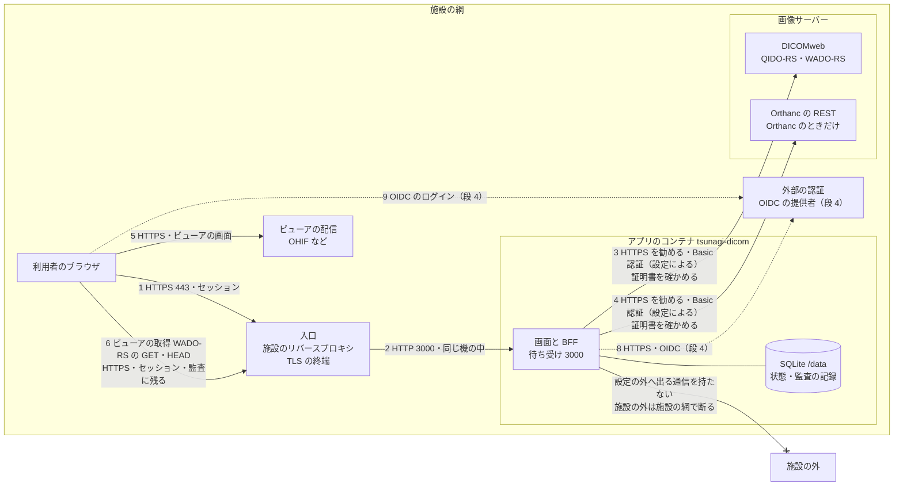

# セキュリティと保守の方針

> **Not for Diagnostic Use / 非医療機器。** このソフトウェアは研究・教育・検証のためのもので、医療機器としての承認・認証を受けていない。この文書は、施設がこのソフトウェアを置くかどうか・どう置くかを決めるための材料で、安全を保証するものではない。
>
> 状態：段 1a（2026-10-18）。段 1b より後の機能は予定として書き、その印（「段 X」）を付ける。仕様は [`spec.md`](spec.md)、厚生労働省のガイドライン（第7.0版）の項目との対応は [`guideline-mapping.md`](guideline-mapping.md)。

## 1. 方針

- **このソフトウェアが担うこと**：画像サーバー（DICOMweb・Orthanc）の前に置く Web の画面と BFF。利用者の認証（段 1b から）、役割ごとの操作と返す項目の絞り込み（段 1b・2）、ビューアが画像を取る道の中継（WADO-RS の読み取りだけ）、操作の監査の記録（前の行のハッシュをつなぐ）。
- **担わないこと**：入口の網の制御（TLS の終端・VPN・接続元の制限）、サーバーの OS とコンテナの土台の管理、画像サーバーとビューアの安全、バックアップと復旧、時計の合わせ（NTP）、端末の管理。これらは施設が行う。
- **安全を既定にする**：設定しなければ認証が有効、証明書の確かめを切る設定を持たない、秘密に既定値を置かない、画像サーバーの資格情報をブラウザに渡さない。コンテナは root でない利用者・読み取りだけのファイルシステム・権限を落とした形で動く（`compose.yaml`）。
- **アプリが自分から外へ出る通信を持たない**：アプリが通信する先は、設定で与えた画像サーバーと、段 4 の外部の認証（OIDC）だけ。版の確かめ・利用の統計などの知らせは止めてある（`NEXT_TELEMETRY_DISABLED`・`CHECKPOINT_DISABLE`）。**設定で与えた先が施設の外にあれば、その通信は外へ出る。** アプリは接続先が施設の中かを確かめないので、施設の外への通信を断るのは施設の網（コンテナの網・防火壁）で行う。アプリが設定の外へ通信しないことを CI で確かめるのは段 2b。
- **無償の OSS で、保証は無い。** 直しを出す期間・速さは目安で、約束ではない（[6](#6-保守の方針)）。

## 2. システム構成図

勧める配置の例：施設の網の中に、入口・アプリのコンテナ・画像サーバー・ビューアを置き、画像サーバーへは HTTPS と認証でつなぐ。点線は段 4 の予定。暗号化と認証の有無が設定で変わる道は、[3 の通信の一覧](#3-通信の一覧) に条件を書く。



- 番号は [3 の通信の一覧](#3-通信の一覧) の番号。10（コンテナの中の生死の確かめ）は図から省いた。
- **ブラウザは画像サーバーへ直に行かない**（既定の形）。画面の検索は画面の API（1→2）、ビューアの画像の取得は BFF の中継（6→2）を通り、画像サーバーへは BFF だけがつなぐ（3・4）。画像サーバーの資格情報は BFF の中にだけある。
- ビューアの取得先（DICOMweb の URL）を BFF の中継（`/api/dicom-web`）に向けるのは、ビューアの側の設定。ビューアごとの設定の形は段 2 で実測して決める（[`spec.md`](spec.md) の 3.2 の未決）。
- 図に無い道：研究の道具に渡す `PUBLIC_DICOMWEB_URL`（コピー用）は、研究の道具が画像サーバーへ直に行く道で、**このアプリの認可と監査の外**（通信の一覧の 7）。画像サーバーの側で認証と記録を持つ施設のためのもので、既定にしない。
- 図に無い通信：配備の時にコンテナの土台の機がイメージを GHCR から取る通信は、アプリの通信ではない。閉じた網では、イメージを持ち込む（`docker save`・`docker load`）か、施設の中のレジストリに写す。

## 3. 通信の一覧

| # | どこから → どこへ | 口 | 規格 | 認証 | 暗号化 | 備考 |
|---|---|---|---|---|---|---|
| 1 | 利用者のブラウザ → 入口 | 443（施設の決め） | HTTPS | アプリのセッション（段 1b から `AUTH_MODE=local` のログイン） | TLS（入口で終端） | TLS の版の限定・クライアント証明書・接続元の制限は入口で施設が行う |
| 2 | 入口 → 画面と BFF | 3000 | HTTP | 入口は認証しない（アプリが認証する） | 無し | `compose.yaml` の例は `127.0.0.1:3000` だけで待ち受ける（入口と同じ機に置く前提）。別の機に置くなら、その間も TLS にする |
| 3 | BFF → 画像サーバー（DICOMweb） | 施設の決め | QIDO-RS・WADO-RS | Basic 認証（`BACKEND_USERNAME`・`BACKEND_PASSWORD`）か無し | `https://` なら TLS。証明書は必ず確かめる（自前の CA は `BACKEND_CA_FILE`） | `http://` も設定できるが、同じ機の中か閉じた区画の中だけにする |
| 4 | BFF → 画像サーバー（Orthanc の REST） | 施設の決め | Orthanc の REST | 3 と同じ | 3 と同じ | `BACKEND_KIND=orthanc` のときだけ |
| 5 | 利用者のブラウザ → ビューアの配信 | 443（施設の決め） | HTTPS | 施設の決め | TLS | ビューアの安全はビューアの側（このソフトウェアは改造しない） |
| 6 | ビューア（ブラウザの中）→ BFF の中継 | 443（入口を通る） | WADO-RS の GET・HEAD | アプリのセッション（役割の確かめは段 1b） | TLS（1 と同じ入口） | 検索（QIDO-RS）は返さない。書き込み（POST・PUT・PATCH・DELETE）は 405 で断る。通したものも断ったものも監査の記録に残す |
| 7 | 研究の道具 → 画像サーバー | 施設の決め | DICOMweb | 画像サーバーの側 | 施設の決め | `PUBLIC_DICOMWEB_URL`。このアプリの監査の外。既定にしない |
| 8 | BFF → 外部の認証 | 443 | OIDC | クライアントの秘密（`OIDC_CLIENT_SECRET`） | TLS | 段 4。つなぐ先（OSS）は段 4 の前に決める |
| 9 | 利用者のブラウザ → 外部の認証 | 443 | OIDC | 提供者のログイン | TLS | 段 4 |
| 10 | コンテナの中の生死の確かめ → BFF | 3000（`127.0.0.1`） | HTTP（`/api/health`） | 無し | 無し | コンテナの中だけ。患者の情報も設定の値も返さず、画像サーバーにつながない |
| — | アプリ → 設定で与えた先のほか | — | — | — | — | **無し。** 版の確かめ・利用の統計の知らせは止めてある。CI での確かめは段 2b。3・4・8 の先を施設の外に置けば、その通信は外へ出る（施設の網で断る） |

## 4. 秘密と設定の置き場

設定の正本は [`.env.example`](../.env.example)（値は例の名前だけで、秘密は空）。要点は [`spec.md`](spec.md) の 2.1。

| 秘密 | 何のためか | 渡し方 | 既定値 |
|---|---|---|---|
| `SESSION_SECRET` | セッションの署名 | 値か `SESSION_SECRET_FILE`（`compose.yaml` の例は secret のファイル）。32 バイト以上の乱数 | **無し。** どちらも空なら起動しない |
| `BACKEND_PASSWORD` | BFF が画像サーバーにつなぐ資格情報 | 値か `BACKEND_PASSWORD_FILE` | 無し。`BACKEND_USERNAME` があるのにパスワードが無ければ起動しない |
| `OIDC_CLIENT_SECRET` | 外部の認証のクライアントの秘密（段 4） | 値か `OIDC_CLIENT_SECRET_FILE` | 無し |
| 利用者のパスワード | アプリのログイン（段 1b） | データベースにハッシュ（argon2id）で持つ。平文に戻せない | — |

- **同じ秘密を値と `*_FILE` の両方で渡したら起動しない**（どちらが効いているか分からなくなるため）。
- **ファイルで渡すことを勧める。** 環境変数の値は、コンテナの設定の表示（`docker inspect` など）から読める。secret のファイルはリポジトリに入れない（`secrets/` は `.gitignore`）。
- 起動の時の誤りの文言は、どの変数かだけを出し、値を出さない。
- 証明書の確かめを切る設定（`NODE_TLS_REJECT_UNAUTHORIZED=0`）を与えたら起動しない。自前の CA は `BACKEND_CA_FILE` で渡す。
- 二要素の認証（TOTP）の鍵の持ち方は、段 1b で決めて、この文書に足す。

## 5. 記録

- **監査の記録**（[`spec.md`](spec.md) の 3.6）：誰が・いつ・どの患者と検査に・何をしたを、BFF のデータベース（`/data` の SQLite）に追記だけで残す。各行は前の行のハッシュ（SHA-256）を持ち、途中の書き換え・削除・差し込みを見つけられる。データベースの trigger で、更新・削除・置き換えを断る。
- **確かめ**：`/api/audit/verify`（管理者だけ）で、つなぎを確かめる。壊れていなければ 200 と `{"ok": true, "checked": 行の数}`。壊れていれば 409 と `{"ok": false, "checked": …, "seq": 壊れた行の番号, "reason": 理由}` で、このときの `checked` は壊れた所の前までに確かめた行の数（全部の行の数ではない）。
- **見つけられないこと**：ハッシュのつなぎは書き換えを「見つける」もので、防ぐものではない。**末尾の行を消されたときは、つなぎだけでは見つからない。** 行の数（と、データベースから読める最後の行の番号とハッシュ）を、データベースの外（施設の記録）に時々控えて比べる。
- **持ち出し**：つなぎを確かめられる形（CSV か JSON Lines と、確かめの手順）での持ち出しは段 2b、管理の画面での検索と CSV は段 4。それまでは、`/data` のデータベースの写し（[7](#7-使い終えるときの片付け)）を持ち出す。
- **時刻**：サーバーの時計を使う。時計を NTP で合わせるのは施設が行う。
- **接続元**：信じるリバースプロキシの設定ができるまで、`X-Forwarded-For` などのヘッダーの値は「確かめていない接続元」として分けて残す。
- **バックアップ**：`/data` のバックアップと、その保管の場所の保護は施設が行う。

## 6. 保守の方針

### 6.1 版の付け方

- 版は `vX.Y.Z`（Semantic Versioning の考え方）。
  - `X`：互換の無い変更（設定の変数の名前・意味の変更、データベースの形を戻せない変更、既定の振る舞いの変更）。
  - `Y`：互換のある機能の追加（段の機能を足す）。
  - `Z`：直しだけ（脆弱性の直し・土台のイメージの更新を含む）。
- `v1.0.0` より前（`v0.Y.Z`）は、`Y` が上がるときに互換の無い変更を含むことがある。そのときは、変える設定と移し方を版の説明に書く。
- まだ版を出していない（段 1a）。
- イメージのタグと片付けの決まりは [README](../README.md) の「イメージ（GHCR）」。配備は版のタグか digest を指定する。

### 6.2 支える期間（案。まだ決めていない）

- **案**：
  - `v1.0.0` より前：**最新の版だけ**に直しを出す。
  - `v1.0.0` より後：**最新の `X.Y` と、一つ前の `X.Y`** に、脆弱性の直しを `Z` の版で出す。一つ前の `X.Y` は、新しい `X.Y` を出してから 6 か月で支えを終える（その後は直しを出さない）。
  - 支える版には、土台のイメージ（Node.js・Debian の包み）の、深刻度が高い以上の脆弱性の直しも `Z` の版で出す。
- **保証は無い。** 無償の OSS で、保守の契約は無い。直しを出す速さ・期間は目安で、約束ではない。施設は、支えの終わった版を使い続けるかどうかを自ら判断する。
- **部品の支えの終わり**：このソフトウェアは、土台のイメージ（`node:24-bookworm-slim`。Node.js 24 と Debian 12）と、npm の依存の上に立つ。部品の支えが終わる日は各部品の公式の発表で確かめ、終わる前に土台を上げる（`X` か `Y` の版にする）。土台の大きな版の上げは、Dependabot の PR ではなく、別の PR で試してから行う。

### 6.3 依存の更新とイメージの作り直し

- **Dependabot**：週に1回、npm（直下と `docker/prisma-cli`）・GitHub Actions・Docker（土台のイメージ）の更新の PR を出す（`.github/dependabot.yml`）。PR は CI が緑になってから取り込む。
- **依存の確かめ**：CI で `npm audit --audit-level=high`（深刻度が高い以上で落とす）を、直下とイメージの中の Prisma の CLI の両方に流す。
- **週の作り直し**：毎週、`main` のイメージを層の cache 無しで作り直し、土台のイメージの包みの更新を取り込む（`rebuild-YYYYMMDD` のタグ）。**作り直しは版のタグを付けず、上書きしない。** 版のタグのイメージに包みの更新を入れるには、新しい `Z` の版を出す。
- **SBOM と来歴**：出したイメージには、SBOM と provenance（来歴）を付けている。
  ```sh
  docker buildx imagetools inspect ghcr.io/jeysunit/tsunagi-dicom:vX.Y.Z --format '{{ json .SBOM }}'
  ```
- **署名**：出したイメージの digest に、cosign の鍵の要らない署名（GitHub Actions の OIDC）を付けている。配備の前の確かめ方は [README](../README.md) の「署名の確かめ」。署名はタグではなく digest に付く。

### 6.4 上げ方と戻し方

- 上げる前に、`/data`（データベース）の写しを取る（[7.1](#71-データの持ち出し)）。起動の時に、データベースの形の更新（`prisma migrate deploy`）が流れる。**形の更新は前にしか進まない。**
- 戻すときは、前の版のタグか digest を指定し直し、上げる前に取った `/data` の写しに戻す。

### 6.5 脆弱性の報告の受け方

- 窓口は GitHub の **Private vulnerability reporting**（リポジトリの Security の頁の「Report a vulnerability」）。手順は [`SECURITY.md`](../SECURITY.md)。
- 脆弱性かもしれないことを、公開の Issue・PR・議論に書かない。
- 受けたら、報告者と私的に確かめ、直しの版を出してから、GitHub の Security Advisories で公表する（CVE の番号も、そこで求められる）。
- **目安（案）**：受けてから 7 日のうちに最初の返事、深刻度が高い以上は 30 日のうちに直しの版。目安で、約束ではない。

## 7. 使い終えるときの片付け

このソフトウェアを使い終えるとき、別の機へ移すとき、機を手放すときの手順。BFF のデータベースには、状態（検像・読影・緊急・ブックマーク）・簡易レポート（段 3）・利用者（段 1b）・**患者 ID と検査の組を含む監査の記録**が入る。画像の本体は画像サーバーにあり、このソフトウェアは持たない。

### 7.1 データの持ち出し

1. 入口で、利用者の道を閉じる（新しい要求で監査の記録が増えないようにする）。管理者は、確かめのほかの操作をしない。
2. 管理者で `/api/audit/verify` を流し、`ok` が `true` であることと、行の数（`checked`）を控える。`ok` が `false` なら持ち出しを止め、壊れた行（`seq`）を調べる。
3. アプリを止める（`docker compose stop`）。止めてから写すと、書きかけの無い写しになる。
4. ボリュームの中身（`tsunagi.db` と、WAL のファイル `tsunagi.db-wal`・`tsunagi.db-shm` があればそれも）を、他の利用者から読めない場所に写す。止めたコンテナからも写せるので、別のイメージを取ってくる要りは無い（閉じた網でもそのまま流せる）。例：
   ```sh
   umask 077
   mkdir -m 0700 export
   docker cp "$(docker compose ps -aq tsunagi)":/data/. export/
   chmod -R go-rwx export
   ```
5. 写しを開き、監査の記録の行の数と最後の行の番号が、2 の `checked` と合うことを確かめ、最後の行のハッシュを控える（例：SQLite の道具で `SELECT count(*), max(seq) FROM AuditLog;` と `SELECT hash FROM AuditLog ORDER BY seq DESC LIMIT 1;`）。写しそのもののつなぎを確かめる手順は、持ち出しの形と一緒に段 2b で足す。
6. 写しを施設の決めた保管の場所へ移す。写しは患者の情報を含む。保管の場所・期間・持ち出しの記録は、施設の規程に従う。

### 7.2 データの消し方

- コンテナとボリュームを消す（`docker compose down --volumes`）。ボリュームを名指しして `docker volume rm` で消すときは、先にコンテナを消す（止めただけのコンテナが残っていると、使用中として消せない）。ボリュームの名前は compose の project の名前が頭に付く（`docker volume ls` で確かめる）。
- **ボリュームを消しても、下の記憶装置の上には中身が残ることがある**（SSD・コピーオンライトのファイルシステム・スナップショット・バックアップ）。安全に消すのは、記憶装置の側で行う：暗号化した記憶装置なら鍵を消す、機を手放すなら記憶装置ごと消す（装置の安全な消去の機能か、物理の破壊）。スナップショットとバックアップの中の写しも、施設の規程に従って消す。
- 持ち出した写し（7.1）も、要らなくなったら同じように消す。

### 7.3 秘密の消し方

- secret のファイル（`secrets/` の中）と `.env` を消す。
- **画像サーバーの側で、BFF が使っていた資格情報（利用者）を消すか無効にする。** ファイルを消しても、資格情報そのものは画像サーバーで生きている。
- 外部の認証（段 4）を使っていたら、提供者の側でこのアプリのクライアントを消す。
- `SESSION_SECRET` を消せば、それで署名したセッションは使えなくなる。

### 7.4 イメージの片付け

- 手元のイメージを消す（`docker image rm`、作りの cache は `docker builder prune`）。イメージには患者の情報も秘密も入らない（モックの合成の見本だけが入る）。
- 施設の中のレジストリに写していたら、そこからも消す。
